# Review of the 3D head model, and what to use instead

23 October 2026. Written for Ian. Brief: `docs/MODEL_REVIEW_BRIEF.md` (the
original, before your answers, is `oralcheck-agent/anatomy3d/MODEL_REVIEW_PROMPT.md`).
Pictures are in `docs/model-review/`. The prototypes, with both reels and the
plates you can switch, are a private artifact:
https://claude.ai/artifact/HNkBy65udqitq3m3WhvyRW. This review is also a private
artifact, with the pictures inline: https://claude.ai/artifact/6fwVAT9B2fAG7iYq6ffYbj.

## The short answer

**Your instinct is right: there is a better solution, and it is not a better 3D
model.** The current model looks off for reasons that sit in the source data,
not in the colours or the lighting, so another round of shader fixes will not
get it to "professional". For what OralCheck needs (teach where mouth cancers
start and what they look like, credibly, mostly as Instagram stills and reels),
**layered 2D illustration in the textbook style you picked does the job better
than 3D**, costs nothing to run, and is easier to keep accurate.

I built prototypes of that route so you can judge it rather than take my word:

- **Plate A, mouth and throat only:** the open mouth from the front, "say ahh",
  with five switchable lesions (white patch, red patch, ulcer, lump, lip sore).
- **Plate B, mouth first with the head faded:** a side cut-away with a ghost
  head, and switchable "where it starts" zones.
- **Two 12-second reels with identical captions and timing,** one made from the
  illustrations, one from the 3D model turning, so you can compare on your phone.
- **Two 4:5 posts.**

What I recommend, and why the other routes lost, is in
[Recommendation](#recommendation). The decisions left for you are at the end.

## What you decided (23 October)

You picked the **rendered textbook illustration** look (Blausen Medical), and
ruled out photoreal 3D, the current muscle view and the current see-through
mode. The job is teaching where it starts plus credibility with clinicians; the
main use is Instagram; the face should be a **faded side silhouette**; you
want **illustrated, switchable lesions** at the real sites, checked against
published photos only for now (no clinician yet); you prefer a **one-off
payment** if anything is bought; you want **both scopes and both motion styles
prototyped** before choosing; the website location is open.

## 1. What "professional" looks like

From the reference research (Blausen, Cancer Research UK, Kenhub, TeachMeAnatomy,
Netter, the 3D atlases, cancer-centre pages; full notes and every link are in
the appendix):

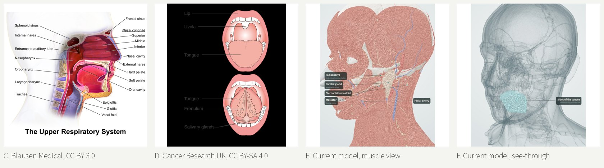

*C and D are openly licensed and can be shown here. The two copyrighted
examples you also looked at are linked instead:
[VOKA 3D atlas, head and neck muscles](https://voka.io/3d-anatomy/head-and-neck/muscles/)
(photoreal 3D) and
[NCI, Parts of the Oropharynx, Terese Winslow](https://www.eurekalert.org/multimedia/890756)
(painted patient illustration).*

What the good ones do, concretely:

1. **One idea per picture.** A single cut, a dozen labels, one title. The eye
   has one place to go. The current viewer holds about 960 structures and shows hundreds at once.
2. **No face, or a ghost of one.** Blausen draws the head as a near-white
   silhouette that fades into the page: no eyes, no skin, no hair. Kenhub and
   Netter crop to the lips; Cancer Research UK draws only the lips. None shows
   a full face with eyes. This is how they avoid the uncanny feeling.
3. **Rendered, not photographed.** Soft shading, a little shadow in hollows, one
   gentle highlight on wet surfaces, and a stylised stipple for tongue papillae.
   No photo textures.
4. **Cut surfaces are flat and lighter** than the cavities behind them, so a cut
   reads as a cut.
5. **The subject is coloured, the context is grey.** TeachMeAnatomy keeps the
   anatomy muted and gives colour only to what is being taught. That is exactly
   how lesions should be shown.
6. **One line system, used consistently.** Either no outlines (Blausen) or one
   thin outline everywhere (Cancer Research UK). Mixing the two is a common
   amateur tell.
7. **Thin, straight leader lines** to short, sentence-case labels in a plain sans
   serif, set in columns, never crossing.

The 3D atlases (BioDigital, Visible Body, Complete Anatomy, Zygote) all default
to the wet, photoreal look you rejected, and none advertises an illustrated
mode. Their licences also block or charge for Instagram use (see section 3).

## 2. Audit of the current model

I rendered the model from every side and in every mode and preset, and also
tried re-shading it in the textbook style to see whether the shapes underneath
could carry that look. Evidence:

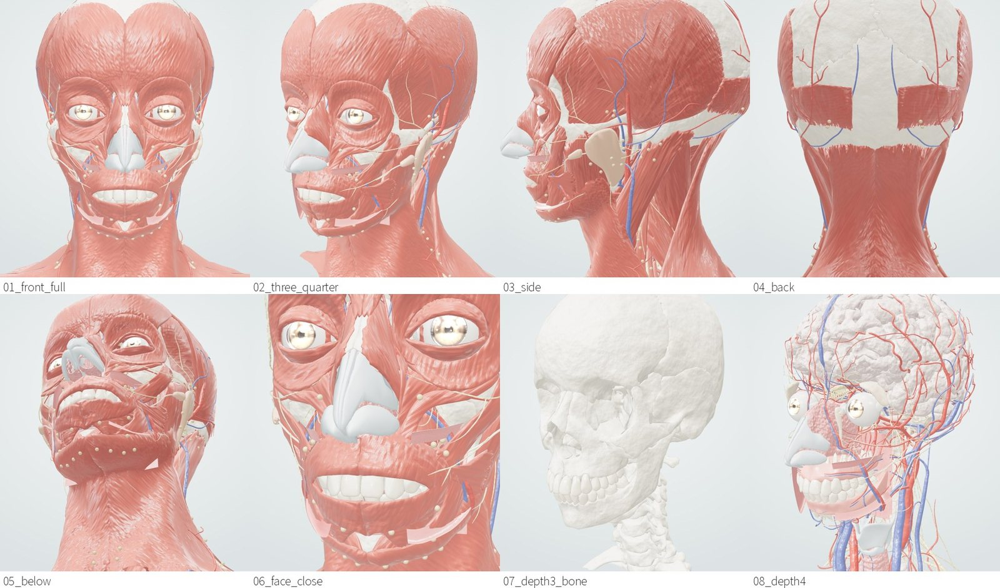

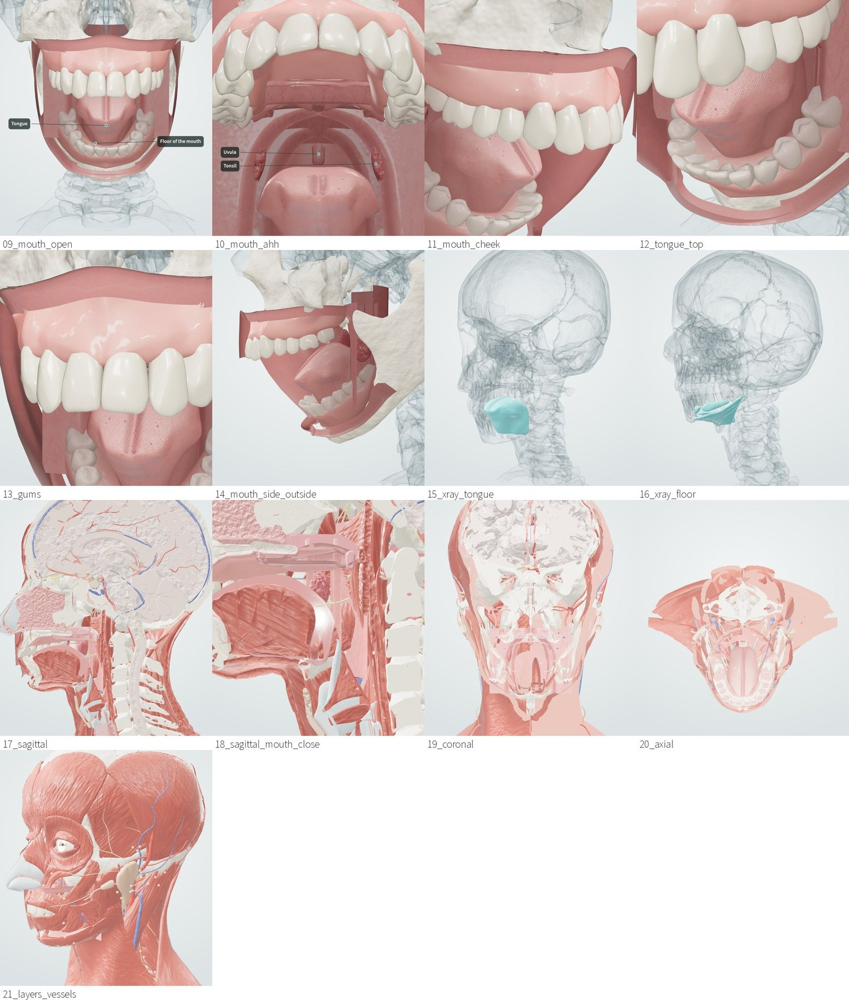

### Why it feels off: the root causes

Three things produce almost everything you have been reacting to, and none of
them is fixable by tuning:

1. **The atlas was built for study, not for pictures.** Z-Anatomy is assembled
   from BodyParts3D, a database of separate organ surfaces. The surfaces are
   hollow shells that often do not close or meet, and some parts are crude. A
   cut down the middle shows it plainly:

   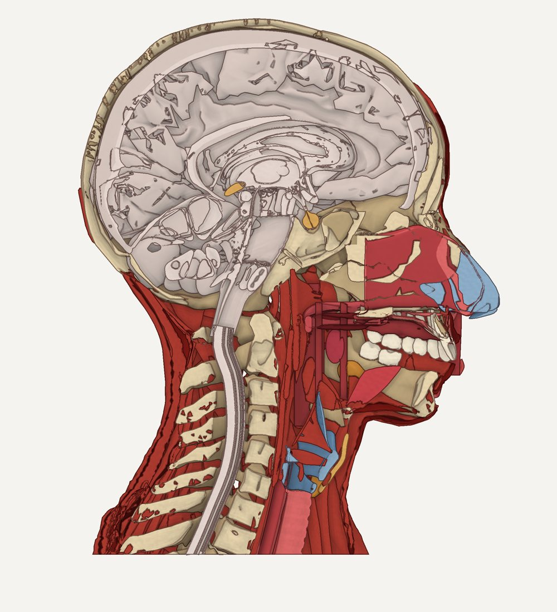

   *The same model cut down the middle, in the new shading. The nasal lining is
   a stack of blocks, the brain is a crumpled shell, the tongue barely
   registers as a solid, and there are slivers everywhere. No shader fixes
   this: the shapes are not there.*

2. **The mouth, which matters most, is where the atlas is weakest.** The atlas
   has no lips, cheek lining, inner lips, floor of the mouth, throat arches or
   proper soft palate, so those were generated by the export script, and they
   look generated: flat sheets and shells.

   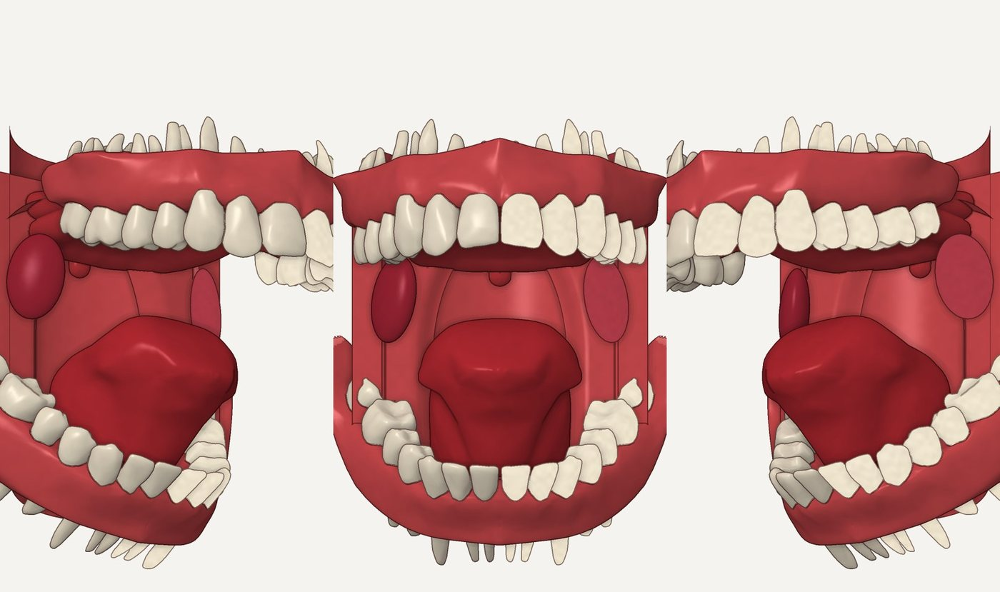

   *Even in the softer illustration shading, the gums are a shell with tooth
   roots poking out above and below, the throat wall is a flat rectangle, and
   the cheeks are cards.*

3. **Realism without a face is the uncanny valley.** Skin was too frightening,
   a mouth on a bare skull looked wrong, and a flayed head with staring eyeballs
   (the muscle view) is the textbook case of "almost human". Professional
   plates avoid this by not showing a face at all, or only a ghost of one.

### Every issue found

Severity: **trust** (breaks trust with a clinician or a viewer), **amateur**
(looks unprofessional), **minor**. Since you have ruled these looks out, costs
are given only as rough effort to fix within the current approach, to show why
replacing it is cheaper.

| # | What and where | Severity | Root cause | Fix within 3D, rough effort |
|---|---|---|---|---|
| 1 | Eyeballs render as chrome balls with bright highlights in a lidless, skinless face (whole-head views, face close-up) | trust | atlas eye parts plus wet shading; no skin | hide eyes, or skin back on: hours, but the face problem returns |
| 2 | Teeth bared in a permanent grin with no lips (front and three-quarter views) | trust | no skin since 23 Oct; atlas has no lips | none without skin |
| 3 | Lymph nodes show as yellow beads scattered over face and neck, like rivets or spots | amateur | atlas nodes drawn at the surface | hide nodes in the whole-head view: minutes |
| 4 | Pink cards float under the lips and chin (inner-lip and floor linings with no face) | amateur | generated linings | hide: done in part; minutes |
| 5 | Back of the head: rectangular muscle patches | amateur | crude atlas parts (occipital muscle) | remodel: days |
| 6 | Muscle reads as one flat salmon colour with fine grain; no fibre direction you can see at phone size | amateur | procedural texture at a scale that disappears | hand-made textures per muscle: weeks |
| 7 | Nose cartilage floats as grey-blue plastic in front of a skinless face | amateur | atlas cartilage, no skin | hide cartilage: minutes; the nose then vanishes |
| 8 | Mouth views: cheek linings are big flat red sheets; the throat wall is a rectangle; the mouth from the side is a box with stepped edges | trust | generated parts | model the cavity by hand: weeks |
| 9 | Tooth roots show above and below the gums in mouth views | amateur | atlas gums do not cover roots | rebuild gums: days |
| 10 | Soft palate is a flat shelf, not hanging down and back | trust (for clinicians) | atlas data; partly generated | remodel: a day |
| 11 | Tonsils small and set at palate level in the atlas (moved by script) | trust (for clinicians) | atlas data | already worked around |
| 12 | Midline cut: crumpled brain, block-like nasal lining, slivers, open shells | trust | atlas meshes are not closed solids | not fixable without new geometry |
| 13 | Coronal and axial cuts are a jumble of slivers with no clear story | amateur | as 12, plus too much shown | show far fewer parts: hours, still messy |
| 14 | See-through mode: a cloud of grey lines (skull and vessels as glass) with one teal blob | amateur | everything ghosted at once | you have ruled the mode out |
| 15 | Wet highlights and clearcoat everywhere, on dry tissues too | amateur | shader settings | hours, but secondary |
| 16 | Labels are dark pills with small type; good idea, heavy look | minor | page design | hours |
| 17 | Too many controls (Look, Cut, presets, search, peel) for a visitor who wants one answer | amateur | built as a viewer, not a lesson | redesign: days |
| 18 | About 10 MB of model plus WebGL: slow on phones, fails on weak ones, battery-heavy | trust (for a health site) | 3D | compress to about 4 MB: a day; still WebGL |
| 19 | No text alternative, no keyboard path to the content, motion everywhere | trust (accessibility) | viewer design | days |
| 20 | Every still and reel must carry a CC BY-SA credit, and anything made from the model is itself CC BY-SA | minor | Z-Anatomy licence | none; it is the licence |
| 21 | Label checks pass (they work well) | strength | your earlier fix | keep the idea |
| 22 | The mouth interior colours (teeth, gums, tongue) were well matched to clinical photos | strength | earlier work | carried into the new plates |

**What is worth keeping:** the atlas's overall proportions (useful as a tracing
reference), the colour matching from your clinical photos, the label-checking
idea, and the render pipeline, which the prototypes reuse.

## 3. The routes, compared

Judged first on how a still and a reel look on a phone, then credibility, cost
(one-off), whether the licence allows Instagram, and effort. Prices and terms
were checked on 23 October; the details and links are in the appendix.

| Route | Look on a phone | Credibility | Cost | Instagram licence | Effort | Verdict |
|---|---|---|---|---|---|---|
| **Fix the Z-Anatomy 3D pipeline** | Still crude (sections 2 and 4) | Weak where it matters, the mouth | Free | Yes, CC BY-SA, credit on everything | Weeks, with no guarantee | **Lost:** the problems are in the shapes |
| **Buy a 3D model, restyle it** (CGTrader head cross-section $49.50; Fab 3D4Science head $64.99; TurboSquid oral cavity $249) | Could be good with weeks of Blender work | Good | $50 to $250 once | Renders allowed, no credit; **AI use barred** | Weeks of 3D work, plus lesions in 3D | **Lost:** most of the cost is the restyle, and 2D gets there faster |
| **3D subscriptions** (BioDigital, Visible Body, Complete Anatomy, Zygote from $98 a month) | Photoreal, the look you rejected | High | Monthly | **Blocked or paid permission** for social posts | Low | **Lost:** wrong look, wrong licence |
| **Blausen plates, CC BY 3.0** (the look you picked) | Professional today | High | **Free** | **Yes**, credit only, no share-alike, edits allowed | Low to use; lesions must be added | **Strong fallback**: fixed views, raster, used widely |
| **Kenhub painted plate** | Professional | High | $83.19 per image (10 years) | Yes, up to 100,000 views a year; credit on every use | Low | Possible for one hero image |
| **Netter** | Classic | Highest | $282 for one year of web use | Time-limited | Low | **Lost:** expires |
| **Commission an illustrator** | Best | High, and can be checked by an anatomist | About $500 to $3,400 per plate | Negotiated | Weeks, external | Worth it later, for the lesion set |
| **Original layered 2D, built here** (the prototypes) | Clean textbook look, crisp at any size | Proportions from the atlas, shapes corrected by hand | **Free** | Yes, but CC BY-SA (it is traced from Z-Anatomy) | Days to polish | **Recommended** |

## 4. The prototypes

### How they are made

The outlines are **traced from the atlas**, not drawn freehand: the renderer
draws each structure as a flat shape from the side or the front, and a tracer
turns those shapes into smooth vector outlines. That keeps the proportions
honest. Where the atlas is wrong or missing (the soft palate, lips, throat
wall, uvula, tonsils, pillars, cheeks), the part is redrawn by hand over the
traced reference, the way an illustrator would. Everything is then styled as a
textbook plate: soft shading, flat cut surfaces, one consistent outline, a
paper background, and a ghost head.

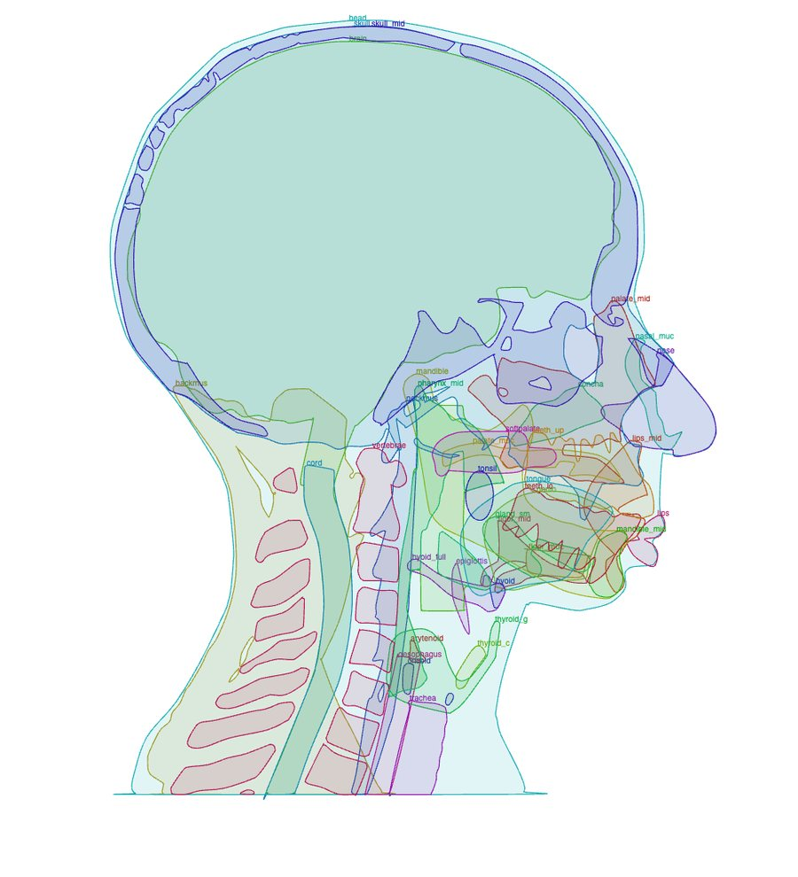

### Plate B: mouth first, head faded

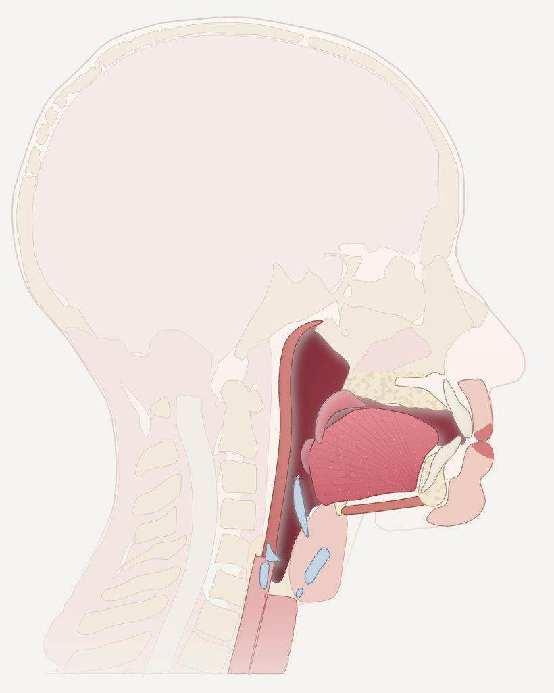

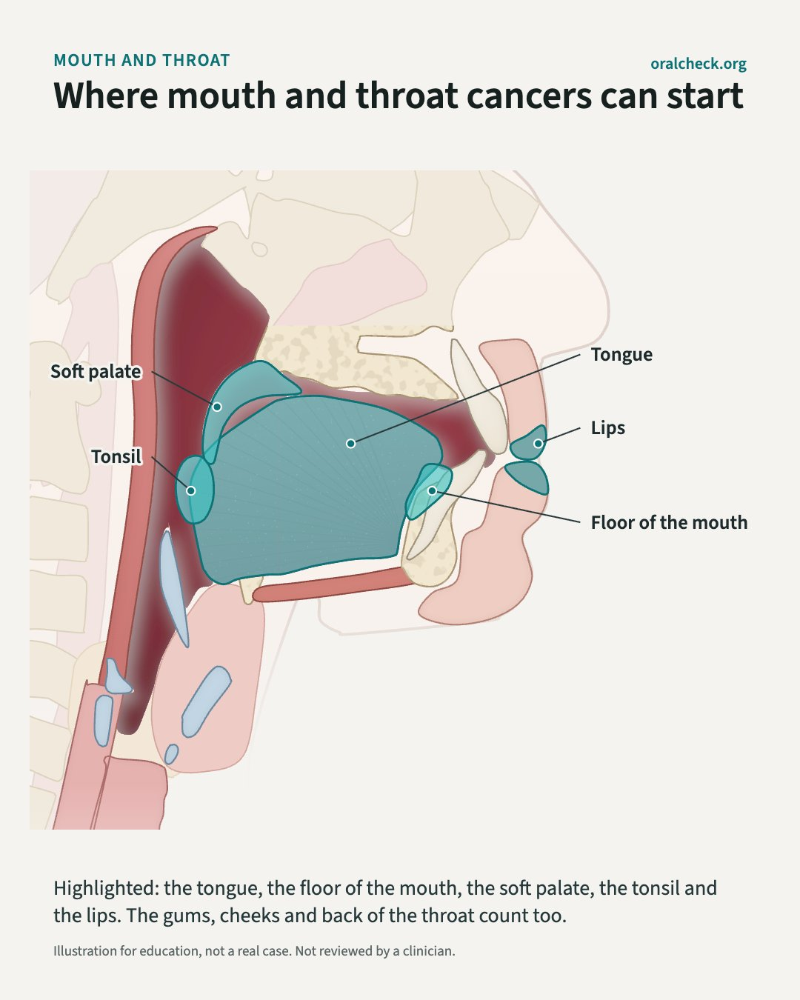

### Plate A: mouth and throat only

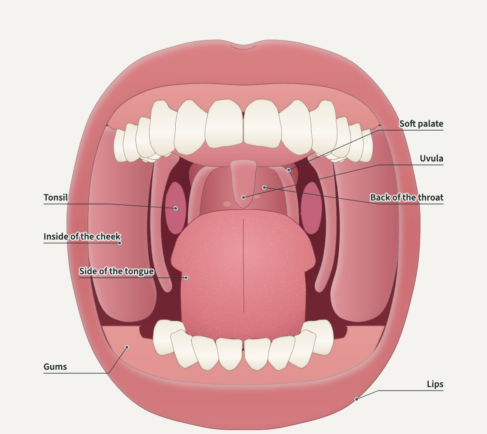

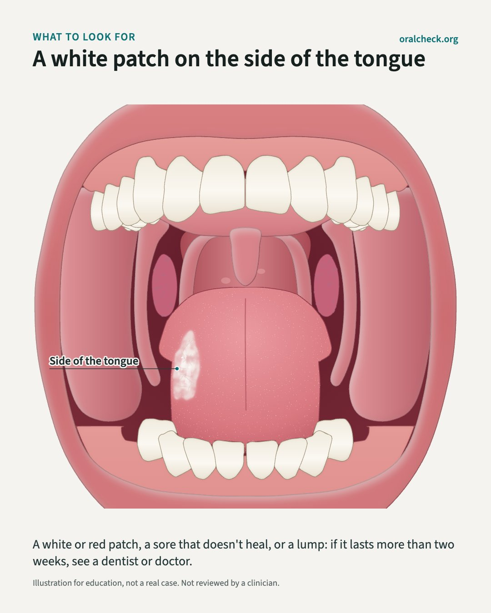

### Lesions, one at a time

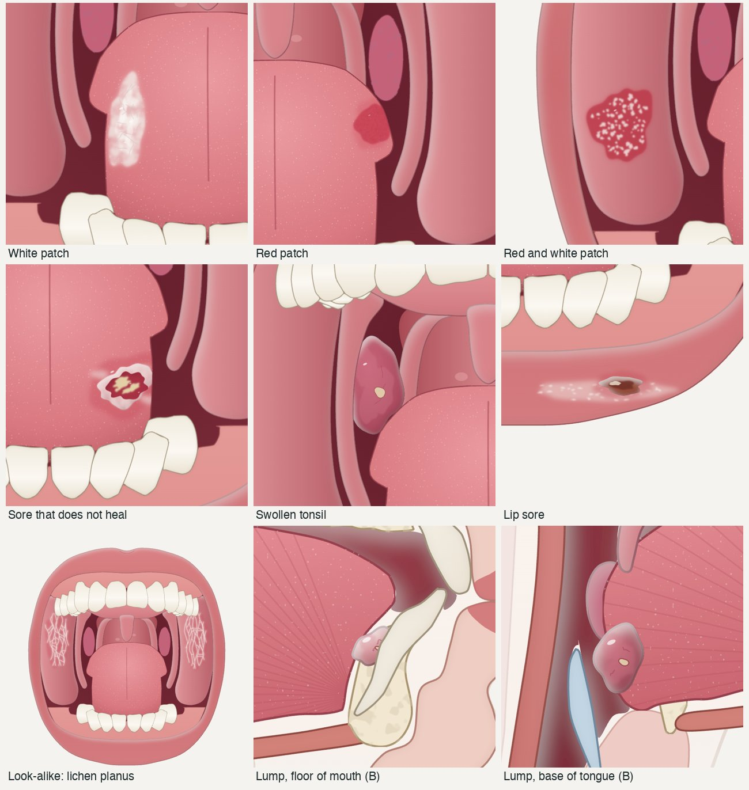

*Redrawn on 23 October against the reference photos in section 5. Top row: white
patch on the side of the tongue, red patch on the side of the tongue, red and
white (speckled) patch inside the cheek. Middle: sore that does not heal on the
side of the tongue, one swollen uneven tonsil, crusted sore on the lower lip.
Bottom: lichen planus on both cheeks (a look-alike), and on plate B a lump in
the floor of the mouth and one at the base of the tongue. Each is switched on
alone, at its real site and at the right depth (a tonsil lump sits behind the
pillar, a cheek patch is clipped to the cheek).*

### The two reels: illustration (top) and 3D (bottom)

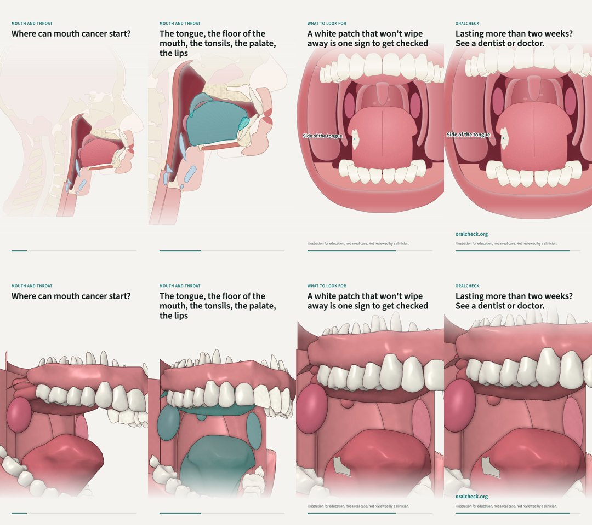

Same words, same timing, 12 seconds, 1080 by 1920. The videos are in the
artifact and can be rebuilt (see directions). The 3D version uses the same
illustration shading on the atlas mouth, the best the atlas allows; it shows
the flat gum shells, the roots and the sheet-like throat even so.

### Honest limits of the prototypes

- **The lesions need real drawing work.** They are small and simple. Each needs
  to be redrawn against the reference photos in section 5, larger, with the
  textures the sources describe (ridged white, velvety red, rolled ulcer edge).
- **The side cut-away is a teaching schematic,** like the NCI and Blausen plates,
  not a precise section: the tongue is shown in side view, and the larynx,
  pharynx and soft palate are simplified.
- **Clinician check:** nothing here has been reviewed by a clinician. Every
  frame says so.
- **Licence:** because the outlines are traced from Z-Anatomy, the plates are an
  adaptation and must be shared CC BY-SA 4.0, with a credit line. For a free
  health project that is fine (it even helps others reuse them), but it means
  OralCheck cannot stop others reusing them.

## Recommendation

**Go 2D. Build the illustrated set from these prototypes, and stop investing in
the 3D head.**

- **Scope:** keep **both** plates, because they answer different questions:
  plate B answers "where", plate A answers "what does it look like". If you
  want one, pick A: it is where lesions are visible face-on, and it is the view
  people see in a mirror.
- **Motion:** use **animated illustration** for reels (zoom, pan, layers and
  lesions fading in). Judge the two clips yourself, but in my view the 3D clip
  shows exactly the problems you named, and the 2D clip does not.
- **Cost:** **$0.** Spend money only if you later want a polished hero image
  (Kenhub, $83) or a professionally drawn lesion set (a commission, roughly
  $500 to $2,500), ideally once a clinician can check it.
- **Blausen as the fallback:** if you need a polished plate before ours is
  finished, Blausen's CC BY plates are free, allow edits, and need only a credit.
- **The 3D head:** leave the existing artifact as it is (do not delete it; it
  documents the work), stop adding to it, and do not put it on the site. The
  reels can keep using `reel3d` until illustrated reels replace them.

**Is 3D the right tool at all?** For this site, no. 3D earns its cost when
people need to turn something to understand it, for example how muscles wrap
a joint. Mouth cancer education needs the opposite: a clear view of a few
places and what a patch or sore looks like there. Every professional
patient-education source we looked at uses flat illustration or photos for
exactly this.

## 5. Lesion set: plan and sources

Captions use the site's own wording ("more than two weeks"), which matches the
American Dental Association, the Oral Cancer Foundation and Mayo Clinic's
leukoplakia page. The NHS says three weeks for an ulcer; the US sources are
used because OralCheck's figures are US (SEER).

| Lesion | Drawn at | What the drawing must show | References to match (licence) | Status |
|---|---|---|---|---|
| White patch (leukoplakia) | Side of the tongue (the most common site for tongue cancers) | White or grey, will not wipe off, rough or ridged or smooth, irregular edge | `File:Severe_dysplasia.jpg` (CC BY-SA 4.0, white patch, left side of tongue); `File:NIH_DOC_16_HomogenousLeukoplakia.jpg` (public domain, floor of mouth) | drawn 23 Oct (side of tongue) |
| Red patch (erythroplakia) | Side of the tongue in the prototype; also floor of mouth, underside of tongue, soft palate | Bright red, velvety, sharp edge | No openly licensed photo found; Cancer Research UK's pictures page (view only) | drawn 23 Oct from the description; flat, velvety, edge clear but not outlined |
| Mixed red and white (speckled) | Inside of the cheek near the corner of the mouth (as in the NIDCR photo); also floor of mouth, soft palate | Red with small white flecks | `File:NIH_DOC_19_Erythroleukoplakia.jpg`, `File:Eritro.jpg` (both public domain) | drawn 23 Oct |
| Ulcer that does not heal | Side of the tongue, floor of mouth | Raised, firm, rolled edge, red or yellow-grey base (unlike a canker sore's yellow base and red halo) | `File:Carcinomatongue.jpg` (CC0); canker sore for contrast: `File:Aphthous_stomatitisNZ.jpg` (CC BY 4.0) | drawn 23 Oct (side of tongue): rolled pale rim, raw base, yellow slough |
| Lump or thickening | Cheek, side of tongue; tonsil for the throat | Firm swelling, uneven surface | `File:NIH_DOC_18_Nodularleukoplakia.jpg` (public domain); NHS symptoms page captions | drawn 23 Oct: tonsil (plate A), floor of mouth and base of tongue (plate B) |
| Lip change from sun | Lower lip | Persistent white, sandpapery or crusted patch, blurred lip border | `File:Actinic_Cheilitis_Photo.jpg`, `File:Left_lower_lip_cancer.jpg` (both CC BY-SA 4.0) | drawn 23 Oct: scaly pale border, crusted sore |
| Lichen planus (a look-alike) | Both inner cheeks | Lacy white streaks | `File:Lichen_planus.jpg` (CC BY-SA 4.0) | drawn 23 Oct, both cheeks; captioned as a look-alike: not cancer, but still worth showing a dentist |

Every lesion image carries: "Illustration for education, not a real case. Not
reviewed by a clinician." My recommendation, even though you chose sources only:
before lesion images go out as a series, ask one dentist or oral pathologist to
look at the set once. Dr. Rawal is an oral pathologist; this is the kind of
narrow, quick check he could do without any name going on anything.

## 6. Directions for use

### For the social pipeline (first)

- **Safe to post now:** the two posts in this review, as drafts for your eye,
  with the credit line in the caption:
  "Illustration based on Z-Anatomy (CC BY-SA 4.0) and BodyParts3D (CC BY-SA 2.1 JP).
  Shared under CC BY-SA 4.0."
- **Framing in every caption:** educational, not a diagnosis; "see a dentist or
  doctor if it lasts more than two weeks"; never "this is cancer".
- **One lesion per image or per reel beat.** Never show all seven at once in a
  post; the combined view is for checking only.
- **Do not post** the full-head ghost alone (it says nothing), or any 3D render
  of the atlas mouth.

### For you (no code needed)

- **Rebuild everything** (plates, posts, lesion crops, both reels) from the
  model:

  ```bash
  cd oralcheck-agent/illustration && ../.venv-stats/bin/python3.11 build_all.py ~/Desktop/oralcheck-illustrations
  ```

  It takes a few minutes; add `--no-video` for stills only. It needs the
  `anatomy3d/head.glb` in your main checkout.
- **Change a caption:** the reel words are in `CAPTIONS` at the top of
  `oralcheck-agent/illustration/make_reel.py`; post words are in `make_post.py`.
- **Never:** remove the "not a real case" line, post a lesion without its
  caption, or drop the CC BY-SA credit.

### For visitors (if it goes on the site)

"Tap a place to see where mouth cancers can start. Tap a sign to see what it
can look like. These are drawings, not photos of real people."

## 7. Where it could live on oralcheck.org

The site already has the right pages: `/learn/signs`,
`/learn/white-and-red-patches`, `/learn/self-exam` and `/learn/oral-cancer`.

- **Recommended:** plate A with its lesion switches on `/learn/signs` and
  `/learn/white-and-red-patches` (one switch per sign, a short sentence under
  each); plate B with the zones on `/learn/oral-cancer`; and a link from the
  results page to `/learn/signs`. No separate "3D model" page.
- **How it loads:** the plates are inline vector drawings of about 70 to 80 KB
  each, no WebGL, no model file. They load with the page and never block the
  screener.
- **Phones:** vector, so crisp at any size; switches as large buttons under the
  drawing, not on it.
- **Accessibility:** each switch is a real button with a text label; each drawing
  has a text description; nothing moves unless the visitor taps, and nothing
  animates for visitors who ask for reduced motion.
- **Translations:** labels and captions come from `messages/*.json`, so the
  Spanish and Portuguese pages get them like any other text.
- **SEO:** the explanatory text sits in the page, not in the picture.
- **Medical framing:** the same line as the posts, plus the site's existing
  "not a diagnosis" wording.
- **Code:** none written in this round. The repo's Next.js has breaking changes,
  so the guides in `node_modules/next/dist/docs/` must be read first.

## Decisions for you

1. **Direction:** illustrated 2D (recommended), or keep 3D. Watch the two reels
   on your phone first.
2. **Scope:** both plates (recommended), or only A, or only B.
3. **Lesion check:** sources only, as you chose, or ask one clinician to look
   once before a lesion series goes out (recommended).
4. **Website:** the Learn pages above (recommended), or not yet.

## Side findings

- **Correction to the brief:** OpenStax Anatomy and Physiology 2e is now
  CC BY-NC-SA, not CC BY. Older OpenStax figures on Wikimedia Commons stay
  CC BY 4.0.
- **The Sketchfab Store has closed;** paid models moved to Fab.
- **NCI Visuals Online did not resolve** on 23 October (no DNS record), and
  Terese Winslow's NCI images need her permission and fee for Instagram.
- **Several paid 3D licences bar AI use** (Fab, CGTrader, TurboSquid). If any
  OralCheck step feeds renders into an image or video generator, those models
  cannot be used.
- **`oralcheck-agent/venv`** runs Python 3.14 but its numpy is built for 3.13,
  so `import numpy` fails there. No pipeline script imports numpy directly, so
  nothing is broken today; noted in case one does.

## Appendix: references and licences

The full research notes, with every price, licence term and link checked on
23 October, are reproduced here.

All pages checked 2026-10-23 unless marked otherwise. "Unverified" means I could not open the page or confirm the figure myself. Prices are as displayed on the page, before tax. Hex values were sampled by me from 960 px Commons thumbnails (5x5 pixel averages and a colour histogram), so treat them as approximate.

Two corrections to the brief, found during the research:

- **OpenStax Anatomy and Physiology 2e is now CC BY-NC-SA 4.0, not CC BY 4.0.** The book details page (last updated 12 Jun 2026) says so. Older OpenStax figures already on Wikimedia Commons, taken from the 2016 edition, stay CC BY 4.0 because CC licences cannot be revoked. Example: `File:1402_The_Tongue.jpg`, CC BY 4.0, from OpenStax version 8.25 dated 18 May 2016.
- **The Sketchfab Store has closed.** Paid models moved to Epic's Fab marketplace (Sketchfab blog, 22 Oct 2024). Free and view-only models stay on Sketchfab.

---

### 1. What makes professional medical illustration look professional, not uncanny

Sources examined: Blausen "Upper Respiratory System" (`Blausen_0872`), Blausen "Mouth" (`Blausen_0653`), CRUK mouth diagram (`CRUK 331`), the Kenhub "Overview of the oral cavity" plate (Paul Kim), the TeachMeAnatomy "Divisions of the Oral Cavity" figure, and the Netter "Cancer of the Oral Cavity and Oropharynx" plate preview (Elsevier). I could not open NCI Visuals Online (see section 2), so I have no direct Terese Winslow observations.

- **One idea per plate.** The Blausen respiratory plate shows a single midsagittal cut, 17 labels and a one-line title. Netter fits several cases on one page, but as separate vignettes with white space between them. Nothing is crowded, and the eye has one place to look.
- **The face is a ghost or is cropped away.** Blausen draws the head as a near-white silhouette, about #E8E6E9 to #F4F3F6 (a cool, slightly lavender pale grey). Its soft edge fades into the white page. There are no eyes, no skin texture and no hair, only the profile line. The anatomy appears where the cut opens the silhouette. Kenhub and Netter crop to the lips. Kenhub's skin fades to white within a centimetre of the mouth, and gloved hands with retractors hold the lips apart. CRUK draws only the lips. None of these sources shows a full face with open eyes, which is what avoids the uncanny look.
- **Rendered, not photographed.** Blausen uses smooth 3D-style shading: soft ambient occlusion in the cavities, one gentle specular highlight on moist surfaces (tongue, nasal conchae) and no photographic texture. The tongue dorsum gets a fine, stylised papilla stipple, not real papillae. That is the line between "clean rendered textbook" and the raw Complete Anatomy or VOKA look.
- **Cut surfaces are flat and lighter than the lumen.** On Blausen, the sectioned bone (hard palate, vertebrae, sphenoid) is a flat pale mauve-grey, about #BCB0B3 to #C1ACAE, with a sparse cancellous stipple in a darker #9B8681. Fat is a flat warm yellow, about #F9B561 to #FAE6B3, and cartilage and the trachea a lavender, about #8F83BA. The cut plane reads as "sliced", while the lumen surfaces behind it carry the shading and depth.
- **Mucosa is a saturated but dark crimson, with the tongue brighter.** Blausen samples: pharynx and nasal lining #9B293C to #B43750, shadow #6F1A25; tongue (sagittal plate) #E13D4A to #E5303C. In the Blausen open-mouth plate the tongue is more natural, #C3716C to #C68279, the gingiva #D1979F and the palate #A65B4F. The Kenhub product page lists its plate's swatches as #C43A33, #A56357, #662022, #5F5354, #91B0E5 and #CFADC9. Muscle in that set sits around #C43A33, with shadow #662022.
- **The background is pure white, or white with a vignette.** Blausen measures #FDFDFD to #FFFFFF. Nothing sits behind the anatomy except the ghost silhouette.
- **3D structures have no outlines; flat-vector styles use one thin line.** Blausen separates structures by tone alone. CRUK is flat vector: one thin dark outline (about #333333), flat fills (lip #F29A99, tongue #F4AFA4, deeper rim #F2867D) and a radial white glow at the back of the throat for depth. Use one system or the other: mixing outlined and unoutlined structures is a common amateur tell.
- **Leader lines are thin, straight, single-weight and unadorned.** Blausen uses thin black lines with no dots or arrowheads. The labels sit in two outer columns, left and right, ragged toward the image. The lines fan diagonally and none of them cross. Kenhub uses the same layout in mid grey. Lines end on the structure, not short of it.
- **Typography is a neutral grotesque sans.** Blausen sets labels in a regular-weight Arial or Helvetica-like face in black, with a bold title at the bottom. CRUK uses a similar sans in #333333. The labels are sentence case and short, with no shadows or outlines on the text.
- **Colour coding marks the subject and greys the context (TeachMeAnatomy).** That figure is a greyscale Gray's-style engraving of a sagittal head, with translucent flat colour only on the regions being taught (tongue green, hard palate yellow, soft palate salmon, oral cavity proper blue). This is directly reusable for lesions: keep the anatomy muted and give the lesion the only saturated accent.
- **Lesion plates show the lesion in situ, cropped to the mouth (Netter).** Each Netter vignette shows the lesion on the tongue, floor of mouth or lip in a soft watercolour finish, with retractor or gauze to show the site, and a short caption under each one.
- **Scale and restraint.** In the open-mouth plates (Blausen, Kenhub, CRUK) the mouth fills about 60 to 70 percent of the frame width. In the sagittal plate the head fills about 70 percent, with the labels in the margins. This translates well to 4:5. For 9:16, the labels have to stack above and below, or appear in sequence.

#### How the 3D viewers differ (assessment, based on the pages and grids I saw)

- **BioDigital, Visible Body, Complete Anatomy and Zygote Body** are interactive atlases built for study. They default to a realistic PBR look: wet specular muscle on a dark or grey background. That is the look Ian rejected. The grid of @completeanatomyelsevier is mostly hero renders on black backgrounds. I found no product page that advertises an illustrated or flat "textbook" render mode for any of them (not verified either way).
- **Their output is a screenshot or video capture of the app,** governed by restrictive terms (section 2), not an asset you own and can restyle.
- **Model marketplaces (Fab, TurboSquid, CGTrader) and open datasets (Z-Anatomy, BodyParts3D, NIH 3D) give you the mesh.** You can then render it in Blender with flat or toon shading and a ghost-silhouette head. This is the realistic way to get the Blausen look in 3D with full camera control for 9:16 reels.
- **Sketchfab is a viewer, not a style.** Its free CC models range from scans to stylised work, but the store side has moved to Fab.

---

### 2. Licensing routes with prices

"Social use" below means Instagram reels and stills, plus the website, for a small free health project.

| Route | Example product (URL) | Price as stated | Social video and stills by a small free project | Attribution or share-alike | Notes |
|---|---|---|---|---|---|
| **Blausen gallery on Commons** | Upper Respiratory System, https://commons.wikimedia.org/wiki/File:Blausen_0872_UpperRespiratorySystem.png ; Mouth, https://commons.wikimedia.org/wiki/File:Blausen_0653_MouthAnatomy.png | Free | Allowed, including commercial use and adaptations (CC BY 3.0) | Credit, link to the licence, say if changed. Suggested citation: Blausen.com staff (2014), "Medical gallery of Blausen Medical 2014", WikiJournal of Medicine 1(2), DOI 10.15347/wjm/2014.010. No share-alike. | Permission confirmed by Wikimedia VRT (ticket on the Mouth page). The source file is 2500x2200 px. **blausen.com** redirects to a "site security access" page, so Blausen's own commercial licensing is **unverified**. The library was gifted to UT Austin in 2018 for campus use (sites.utexas.edu/blausen). |
| **Servier Medical Art** | Oral cavity, https://smart.servier.com/smart_image/oral-cavity | Free | Allowed, including remix (CC BY 4.0) | Credit Servier Medical Art | Flat vector style. A useful base for lesion overlays. |
| **Cancer Research UK diagrams on Commons** | Parts of the mouth, https://commons.wikimedia.org/wiki/File:Diagram_showing_the_parts_of_the_mouth_CRUK_331.svg ; also `...parts_of_the_oropharynx_CRUK_332.svg` | Free | Allowed (CC BY-SA 4.0) | The page asks for credit to "Cancer Research UK / Wikimedia Commons". **Share-alike**: if you adapt the diagram (add lesions, recolour, animate), the adapted material must be released under CC BY-SA 4.0 or a compatible licence, with a link to that licence and no added restrictions (legal code s.3(b)). In practice, the adapted frames, and arguably the reel that incorporates them, become CC BY-SA, so anyone may reuse them. Note "adapted, CC BY-SA 4.0" plus the link in the caption. | SVG source, so easy to edit. |
| **OpenStax A&P** | Book details, https://openstax.org/details/books/anatomy-and-physiology-2e | Free | The current edition is **CC BY-NC-SA 4.0**. NC is ambiguous for a public Instagram account, so avoid it. 2016-era copies on Commons are CC BY 4.0. | Credit OpenStax. Current edition: share-alike plus non-commercial. | Use the Commons copies for CC BY. |
| **Kenhub image store** (illustrated, painted) | Overview of the oral cavity, https://store.kenhub.com/products/overview-of-the-oral-cavity-english ; terms, https://store.kenhub.com/pages/licence-terms | One-off per image, 10-year licence. On this image: Science or Standard $7.56; **Commerce Standard $83.19**; Commerce Extended $251.26. Volume discounts: 10% (5+), 20% (25+), 30% (50+). | The Commerce licence lists "website and social media use" and "broadcast video". Standard covers websites and social pages showing the image up to **100,000 pageviews per year combined**, and video up to a 10,000 audience. Extended removes those caps. How Instagram reel views count against "pageviews" is not defined, so ask Kenhub. | A credit line is required on every use: "Image used under license from Kenhub GmbH. Illustrator: <name>", plus "Modified by Licensee" if edited. Missing it triggers a fee equal to the invoice. | Reasonable modification is allowed (crop, recolour, annotate, combine), so lesion overlays are fine. No physical merchandise. |
| **Fab (former Sketchfab Store), 3D** | Complete Human Head Anatomy, 3D4Science, https://www.fab.com/listings/26969416-edc7-4726-80da-50e37410791a | $64.99 Personal (buyer with no more than $100k revenue or funding in the last 12 months), $79.99 Professional | Fab Standard License: rendered video files and images "may be freely distributed" (EULA s.4b). Commercial use allowed. No standalone redistribution of the model. | No credit required | Formats: blend, fbx, glb, obj and others. Tags include mouth, teeth and section. "Allows usage with AI: No" on the listing. |
| Fab, 3D | Teeth pharynx salivary glands, Ebers, https://www.fab.com/listings/b61cc32d-766c-45ea-9fb3-6a151df7866b | $324.99 | As above | None | Professional anatomy studio. FBX only. |
| Fab, 3D | Dental Anatomy 3D Model, Al noor Studio, https://www.fab.com/listings/de69488e-95cb-484b-8d14-8793ce0d3904 | $34.99 to $39.99 | As above | None | Skull, teeth, gums and vessels. No tongue mentioned. |
| Fab, 3D | Tongue Cross Section, Al noor Studio, https://www.fab.com/listings/2d4cea4a-e820-44c6-b8e2-94b806c0f3a8 | $34.99 to $39.99 | As above | None | Histology-style tongue block, not a head. |
| Fab, 3D | Human Body Head Anatomy animation, Vitalis, https://www.fab.com/listings/8e77c274-6761-445b-a684-6f36064c5d96 | "From $39.99" (search results only) | As above | None | Listing **not opened**, contents unverified. |
| **Sketchfab free models** | Pharynx and floor of mouth, University of Dundee, https://sketchfab.com/3d-models/pharynx-and-floor-of-mouth-b262c70bf9bd49c2a5428581b754f24b | Free | **CC BY-NC-SA 4.0**: non-commercial and share-alike. Risky for public social use. | Credit plus share-alike | By medical artist Eve Laws, accuracy approved by an anatomist. |
| **TurboSquid** | Anatomy of the oral cavity cross section, https://www.turbosquid.com/3d-models/3d-anatomy-of-the-oral-cavity-cross-section-2190066 | $249, Standard License | The Standard Royalty Free licence permits rendered "Imagery", including video projects and web advertising. You may not resell renders through stock sites, or use them for AI or ML without authorisation. | No general credit requirement | Maya/Arnold, FBX, OBJ. A sagittal head section with brain. Search results also listed Realistic Human Mouth Anatomy $149, Teeth Tongue Anatomy $59, Oral Cavity $10, Head Tongue and Floor of Mouth (lateral view) $8 (not opened). |
| **CGTrader** | Realistic Human Head Cross-Section, https://www.cgtrader.com/3d-models/science/medical/realistic-human-head-cross-section-anatomy-3d-medical-model | **$49.50** (shown as 50% off $99.00), "Royalty Free License (no AI)" | Terms s.21A.2 list use "as rendered still images or moving images" as permitted | No credit requirement found | 420k polygons. OBJ, FBX, BLEND, glTF. The description names the oral cavity, pharynx and larynx. Published 2025-06-24. |
| CGTrader | Detailed Head Anatomy with cross-section, 3D4SCI, https://www.cgtrader.com/3d-models/science/medical/complete-human-head-anatomy | $89.00, Royalty Free License (no AI) | As above | None | Separate oral cavity component (per a search snippet). |
| **Zygote** | ZygoteBody pricing, https://www.zygotebody.com/pricing | Lite $0/month; Premium "starting at $4/month"; **Professional "starting at $98/month"**, the only tier with "Create and use images*" ("*See end user license agreement") | Images only on the paid Professional subscription, subject to an EULA I did not read | Unknown | Subscription. Zygote's own 3D poly models (zygote.com/poly-models) did not show prices to me: **unverified**. |
| **BioDigital Human** | Terms, https://www.biodigital.com/terms | No public pricing page (biodigital.com/pricing returns 404). A free "Personal Account" exists. | The terms limit content to the application and to non-commercial presentations. Use in "books, websites, videos" or advertising needs "formal permission and an additional license". **The free tier does not cover social posting.** | n/a | Subscription or enterprise. |
| **Visible Body** | https://www.visiblebody.com/legal/permission-to-use-content-from-vb-products | Not stated | The permission page now 301-redirects to Cengage permissions, which says Cengage cannot provide files or images and routes requests via the Copyright Clearance Center. A search snippet of the old VB page said no ad revenue and use only within courses (**unverified**). | n/a | Treat as blocked for Instagram without written permission. |
| **Complete Anatomy (3D4Medical/Elsevier)** | https://3d4medical.com/use-of-imagery-videos | Subscription app. The current page has no fee schedule. A search snippet claimed commercial and ad-driven platform use (YouTube, TikTok) "starts at $300 per image and $1000 per video" (**unverified**: not on the live page today). | Commercial settings need permission via a form | n/a | Not a one-off route. |
| **Netter (Elsevier)** | Cancer of the Oral Cavity and Oropharynx, https://www.netterimages.com/cancer-of-the-oral-cavity-and-oropharynx-labeled-hansen-ca-1e-general-anatomy-frank-h-netter-10251.html | **$282** for "Electronic Formats, Web up to One Year" (2631x1425 JPG) | Time-limited web licence. A separate "Video/Television/Movie" option exists (price not checked). | Credit Elsevier | Expires after a year, so poor value for evergreen posts. |
| **NCI Visuals Online / Terese Winslow** | visualsonline.cancer.gov | Not reachable: the hostname returned no DNS record on 2026-10-23 (checked with 8.8.8.8 and 1.1.1.1). | A copy of a Winslow NCI image on EurekAlert (https://www.eurekalert.org/multimedia/890756) says it is copyright protected, the US Government has reuse rights, and others must contact the rights holder. Winslow's FAQ (https://www.teresewinslow.com/faq) says to email the proposed usage for an estimate. **A third party needs Winslow's permission and fee for Instagram.** | Per the licence | NCI's own public-domain photos still circulate on Commons, for example `File:Mouth_cancer.jpg` (NCI Visuals Online ID 2584, public domain). |
| **Shutterstock** | Pricing, https://www.shutterstock.com/pricing ; licence, https://www.shutterstock.com/license | On-demand: 2 images $29 (2, 5 or 25 packs). Subscription from $25/month billed yearly at $300. | The Standard Image licence covers social media and online video, and use inside AV productions with a budget up to USD $10,000 | No credit required by the licence text I read | Medical illustration quality varies. Search per image. |
| **Adobe Stock** | https://stock.adobe.com/plans | Individuals $29.99/month for 10 credits. Credit packs of 5 to 150 that last a year. Standard assets cost 1 credit; premium cost 12 to 50 credits. | The Standard licence is perpetual. The 500,000 print-run cap does not apply to web and social display. | n/a | The page did not state a per-image dollar price for packs clearly. |
| **Science Photo Library** | sciencephoto.com | **Unverified**: the site blocked my request | n/a | n/a | Rights-managed, quoted per use. |
| **Z-Anatomy** | https://github.com/Z-Anatomy/Models-of-human-anatomy | Free | Allowed (CC BY-SA 4.0). **Renders are adaptations, so they must be shared CC BY-SA.** | Credit "Z-Anatomy - The libre 3D atlas of anatomy - CC-BY-SA 4.0" and "BodyParts3D - The Database Center for Life Science - CC-BY-SA 2.1 Japan" | Blender file. Built on BodyParts3D. One kidney asset is CC BY-NC, so check each part. |
| **BodyParts3D** | https://lifesciencedb.jp/bp3d/info/license/index.html | Free | CC BY-SA 2.1 Japan | The page requires a specific credit line (in Japanese) on every use | Mesh only, no materials. |
| **NIH 3D** | Mouth, Female (3DPX-022826), https://3d.nih.gov/entries/3DPX-022826 | Free | **CC BY 4.0** | Credit | A GLB with gingiva, tongue, hard and soft palate, buccal mucosa, floor of mouth, teeth and salivary ducts, from the Visible Human Female. Another NIH entry (3DPX-004646, head and neck CT) is listed CC BY-NC-ND, which blocks adaptation (search snippet only). |
| **MedicalGraphics free set** | https://www.medicalgraphics.de/en/terms-of-use-of-the-illustrations-in-the-free-illustrations-section/ | Free | **CC BY-ND 4.0**: commercial use OK, but **no modifications**, so you cannot add lesions | Credit and link | Not suitable for the lesion set. |
| **Commissioning an original** | Ohio State HSL medical illustration, https://hsl.osu.edu/resources/medical-visuals/medical-illustration/illustration-pricing | $109/hour. Typical hours: Simple Line 5 to 10, Simple Color 8 to 15, Moderate Color 16 to 25, Complex Color 26+. **+20% for non-OSU clients.** That works out to about $2,090 to $3,270 for a moderate colour plate for an outside client, and $3,400+ for a complex one (my arithmetic). | Licence negotiated | n/a | Other data points: Kaitlin Lindsay (freelance) says custom illustrations typically run $500 to $2,500+ per image, simple pieces take 1 to 2 weeks, and detailed plates 4 to 8 weeks (https://kaitlinlindsay.com/). MedicalGraphics gives a rule of thumb of €300 to 900 (https://www.medicalgraphics.de/en/portfolio-en/medical-illustration-en/). I found no AMI fee schedule; the AMI page I tried returned 404. |

**AI-use flags.** Several paid licences restrict AI. The Fab listings say "Allows usage with AI: No". CGTrader sells "Royalty Free License (no AI)". TurboSquid bars machine learning and AI-generated use without authorisation. If any OralCheck pipeline feeds renders into an image or video generator, these licences are a problem.

---

### 3. Oral lesions for the illustrated set

Sites, in order of what the sources stress: the **lateral borders of the tongue** are the commonest site (Glasgow Dental School). Floor-of-mouth cancers are about 17% of oral carcinomas and are often small (Glasgow). Small symptomless cancers are found mostly in the floor of mouth and the "palato-fauceal complex", meaning the soft palate and tonsillar pillars (Glasgow). The floor of mouth and ventral tongue are named as early mandible-invasion sites, and tongue or floor-of-mouth location raises leukoplakia's risk of turning malignant (PMC5018209). Lip cancer comes from long sun exposure in fair-skinned people (Glasgow), mostly on the **lower lip** (StatPearls Actinic Cheilitis). The oropharynx covers the soft palate, the side and back throat walls, the tonsils and the back third of the tongue (NCI PDQ).

| Lesion | Appearance in plain words | Most common sites (source) | Reference photos (licence) |
|---|---|---|---|
| **Leukoplakia (white patch)** | A white or grey patch that cannot be wiped off. The surface can be rough, ridged, wrinkled or smooth, with irregular edges, and it may be thick or hard. Usually painless (Mayo). "Homogeneous" type: uniform, thin, flat or wrinkled, possibly with fine cracks. "Non-homogeneous": mixed red and white, nodular or verrucous, and higher risk (PMC9065478). Size runs from a few mm (the Commons example below is about 1 cm) to several cm. Over 2 cm is a risk factor (PMC5018209). | Gums, insides of the cheeks, floor of mouth under the tongue, sometimes the tongue (Mayo). In one series: buccal mucosa 36%, lateral tongue 34%, floor of mouth 22% (search snippet, not opened). | `File:NIH_DOC_16_HomogenousLeukoplakia.jpg` (public domain on Commons, from the NIDCR guide: floor of mouth in a smoker). `File:Severe_dysplasia.jpg` (CC BY-SA 4.0, Coronation Dental Specialty Group: a 1 cm white patch on the left lateral tongue). `File:NIH_DOC_17_Leukoplakia.jpg` (public domain, buccal mucosa, early SCC on biopsy). |
| **Erythroplakia (red patch)** | A bright red, velvety plaque, smooth, granular or nodular, with a clear margin against normal mucosa (PMC9065478). Usually not tender. Less common than leukoplakia but much more likely to be cancerous (NIDCR guide). | Floor of mouth, soft palate, ventral tongue, tonsils (PMC9065478). | **No freely licensed photo found on Commons.** Patient-education photo: CRUK "Pictures of mouth cancer" shows a red patch under the tongue (copyright CRUK, view only): https://www.cancerresearchuk.org/about-cancer/mouth-cancer/getting-diagnosed/pictures |
| **Erythroleukoplakia / speckled leukoplakia** | Red areas speckled with small irregular white patches, still mostly white in character (PMC9065478). Mayo calls the raised red areas within white patches "speckled leukoplakia", more likely to show precancerous change. | Floor of mouth, soft palate, ventral tongue, tonsils (PMC9065478). NIDCR example: commissure and buccal mucosa. | `File:NIH_DOC_19_Erythroleukoplakia.jpg` (public domain on Commons, left commissure and buccal mucosa). `File:Eritro.jpg` (public domain, author Aitor III). CRUK pictures page: a speckled ulcer inside the cheek. |
| **Non-healing ulcer** | A broken area of lining that does not heal (CRUK). Advanced cancer often shows "an indurated raised nodule with an ulcerated surface" (StatPearls, Cancer of the Oral Mucosa). Draw it with a raised, firm, rolled rim and a red or yellow-grey base, unlike a shallow aphthous ulcer with a yellow base and red halo. | Lateral tongue, floor of mouth, lower gum in the molar region (Glasgow), lower lip (CRUK pictures). | `File:Carcinomatongue.jpg` (CC0: carcinoma on the lateral tongue). `File:Lower_lip_cancer.jpg` (CC BY-SA 4.0: SCC of the lower lip with sun damage). For contrast: `File:Aphthous_stomatitisNZ.jpg` (CC BY 4.0, DermNet NZ). |
| **Lump or thickening (induration)** | A firm lump or thickening in the cheek or mouth (OCF), or a pale, pea-sized lump with redness on the side of the tongue (NHS image caption). Exophytic or nodular growth (PMC9065478). | Cheek (OCF), lateral tongue (NHS). | `File:NIH_DOC_18_Nodularleukoplakia.jpg` (public domain, right commissure). NHS symptoms page (photos, Crown copyright): https://www.nhs.uk/conditions/mouth-cancer/symptoms/ |
| **Lip change from sun (actinic cheilitis)** | A persistent white plaque with a "sandpapery" feel, and a blurred line between the red lip and the skin. It can become thick, scaly and ulcerated (StatPearls). | Lower lip vermilion (StatPearls). | `File:Actinic_Cheilitis_Photo.jpg` (CC BY-SA 4.0). `File:Left_lower_lip_cancer.jpg` (CC BY-SA 4.0). |
| **Oral lichen planus (mimic, also a potentially malignant disorder)** | Reticular type: a lacy white web of streaks (Wickham's striae) with red borders. Erosive type: red raw areas (PMC9065478). Usually on both sides. | Both posterior cheeks, plus tongue, gums and palate (PMC9065478). | `File:Lichen_planus.jpg` (CC BY-SA 4.0, Ian Furst: white striae on the left buccal mucosa). |
| **Oropharynx (tonsil, back of tongue)** | Often nothing visible early. Signs include a lump at the back of the mouth, a one-sided sore throat, ear pain, and a white patch that does not go away (NCI PDQ, CRUK). | Tonsils, back third of the tongue, soft palate, throat walls (NCI PDQ). | No good open clinical photo found. For a CT, see `File:Tonsil_oropharyngeal_SCC_CT_transverse.jpg` (CC BY-SA 4.0); not useful for illustration. |

Caveat on the NIH DOC images: Commons tags them public domain but lists the "Artist" as "BodyParts3D/Anatomography", which is wrong. The source is the NIDCR guide, which credits "Lesion photos courtesy Jens Jörgen Pindborg". The guide also states that the publication is not copyrighted and may be photocopied freely. Use these photos as drawing references, not as reposted photos.

#### How long before seeing someone (the sources differ)

- **NHS:** see a GP or dentist for a mouth ulcer that has lasted "more than 3 weeks". No fixed period for patches or lumps. https://www.nhs.uk/conditions/mouth-cancer/symptoms/
- **Cancer Research UK:** the symptoms page gives **no time period**, only to get symptoms checked by a GP or dentist (https://www.cancerresearchuk.org/about-cancer/mouth-cancer/symptoms). The referral page sets a 3-week threshold for unexplained ulcers in England and Wales. For lumps and red or white patches, a GP should consider urgent dental referral within 2 weeks (https://www.cancerresearchuk.org/about-cancer/mouth-cancer/getting-diagnosed/referral-specialist).
- **ADA MouthHealthy:** call your dentist if any listed sign lasts longer than **two weeks**. The list covers sores, red or white patches, lumps, thickening and others. https://www.mouthhealthy.org/all-topics-a-z/oral-cancer
- **Mayo Clinic:** the mouth cancer page (dated 16 Jan 2025) gives **no period**, only to book an appointment for symptoms that worry you. https://www.mayoclinic.org/diseases-conditions/mouth-cancer/symptoms-causes/syc-20350997 . The leukoplakia page says to see a doctor for white patches or sores that do not heal on their own within **two weeks**. https://www.mayoclinic.org/diseases-conditions/leukoplakia/symptoms-causes/syc-20354405
- **Oral Cancer Foundation:** contact a doctor or dentist for a sore or lesion that does not heal within **two weeks**. https://oralcancerfoundation.org/discovery-diagnosis/diagnosis/
- **NIDCR (for clinicians, not copyrighted):** "Any white or red lesion that does not resolve itself in 2 weeks should be reevaluated and considered for biopsy". https://www.nidcr.nih.gov/sites/default/files/2026-05/Detecting%20Oral%20Cancer_022125.pdf

In summary, US sources say 2 weeks, while UK sources say 3 weeks for ulcers and use no set wait for patches.

Other patient-education pages with photos: CRUK pictures page (lip, cheek, lateral tongue, under the tongue), NHS symptoms page (image captions describe tongue lumps and patches), Mayo (white patch and red sore images). ADA MouthHealthy has no lesion photos. Not checked: MD Anderson.

---

### 4. Instagram reference accounts

I confirmed each handle by loading the profile on 2026-10-23. The format notes come from the visible grid only. I did not measure reel pacing.

| Account | URL | What works, as seen on the grid |
|---|---|---|
| **@completeanatomyelsevier** (Complete Anatomy; about 117K followers) | https://www.instagram.com/completeanatomyelsevier/ | One structure per tile, centred on black or off-white, with a small watermark. Carousels are marked on the grid. Reels mix presenter-led clips (a big bold caption over the face, like "LITTLE REGION") with 3D fly-throughs. Shows the photoreal look Ian rejected, but its framing discipline is worth copying: one subject, a plain background, lots of margin. Note that `instagram.com/completeanatomy` returned "page isn't available". |
| **@kenhub_english** (about 50.4K followers) | https://www.instagram.com/kenhub_english/ | A question headline in a coloured box over an illustrated plate ("What are the functions of the platysma?"), flat-illustration explainer tiles with a large title, carousels, and presenter reels with burned-in captions. The illustrated style is closest to Ian's target. |
| **@teachmeanatomy** | https://www.instagram.com/teachmeanatomy/ | Carousel slides with a teal title bar ("Contents of the Cubital Fossa"), a labelled colour-coded diagram on top and a mnemonic or bullet block below. Also meme reels and talking-head reels. A good template for a 4:5 "where it appears" slide plus a "what to look for" slide. |
| **@oralhealthfoundation** (UK charity, runs Mouth Cancer Action Month) | https://www.instagram.com/oralhealthfoundation/ | A photo with a brand-coloured caption box in the lower third and the logo top-left. Campaign-led stills. Useful tone for mouth cancer awareness. |
| **@amidotorg** (Association of Medical Illustrators) | https://www.instagram.com/amidotorg/ | Mostly text cards (events, member highlights, "The evolution of medical illustration" carousel). Good for finding illustrators to commission, through member highlights. |
| **@oralcancerfoundation** | https://www.instagram.com/oralcancerfoundation/ | Handle exists. Grid not reviewed. |
| **@cr_uk** (Cancer Research UK) | https://www.instagram.com/cr_uk/ | Handle exists. Grid not reviewed. |
| **@biodigital.human** | https://www.instagram.com/biodigital.human/ | Handle exists. Grid not reviewed. |

Not verified: Visible Body (`instagram.com/visiblebody` showed "page isn't available"; no handle linked from visiblebody.com).

---

### 5. Sources

- https://commons.wikimedia.org/wiki/File:Blausen_0872_UpperRespiratorySystem.png
- https://commons.wikimedia.org/wiki/File:Blausen_0653_MouthAnatomy.png
- https://en.wikiversity.org/wiki/WikiJournal_of_Medicine/Medical_gallery_of_Blausen_Medical_2014
- https://sites.utexas.edu/blausen/
- https://commons.wikimedia.org/wiki/File:Diagram_showing_the_parts_of_the_mouth_CRUK_331.svg
- https://creativecommons.org/licenses/by-sa/4.0/
- https://creativecommons.org/licenses/by-sa/4.0/legalcode.en
- https://commons.wikimedia.org/wiki/File:1402_The_Tongue.jpg
- https://openstax.org/details/books/anatomy-and-physiology-2e
- https://openstax.org/books/anatomy-and-physiology-2e/pages/23-3-the-mouth-pharynx-and-esophagus
- https://smart.servier.com/smart_image/oral-cavity
- https://teachmeanatomy.info/head/organs/mouth/oral-cavity/
- https://teachmeanatomy.info/wp-content/uploads/Divisions-of-the-Oral-Cavity.jpg
- https://www.netterimages.com/cancer-of-the-oral-cavity-and-oropharynx-labeled-hansen-ca-1e-general-anatomy-frank-h-netter-10251.html
- https://store.kenhub.com/products/overview-of-the-oral-cavity-english
- https://store.kenhub.com/pages/licence-terms
- https://www.eurekalert.org/multimedia/890756
- https://www.teresewinslow.com/
- https://www.teresewinslow.com/faq
- https://sketchfab.com/blogs/community/sketchfab-update-what-you-need-to-know-now-that-fabs-live/
- https://sketchfab.com/3d-models/pharynx-and-floor-of-mouth-b262c70bf9bd49c2a5428581b754f24b
- https://www.fab.com/eula
- https://dev.epicgames.com/documentation/en-us/fab/licenses-and-pricing-in-fab
- https://www.fab.com/listings/26969416-edc7-4726-80da-50e37410791a
- https://www.fab.com/listings/b61cc32d-766c-45ea-9fb3-6a151df7866b
- https://www.fab.com/listings/de69488e-95cb-484b-8d14-8793ce0d3904
- https://www.fab.com/listings/2d4cea4a-e820-44c6-b8e2-94b806c0f3a8
- https://www.fab.com/search?q=head%20and%20neck%20anatomy&listing_types=3d-model
- https://www.fab.com/search?q=oral%20cavity&listing_types=3d-model
- https://www.turbosquid.com/Search/3D-Models/oral-cavity-anatomy
- https://www.turbosquid.com/3d-models/3d-anatomy-of-the-oral-cavity-cross-section-2190066
- https://blog.turbosquid.com/royalty-free-license/
- https://www.cgtrader.com/3d-models/science/medical/realistic-human-head-cross-section-anatomy-3d-medical-model
- https://www.cgtrader.com/3d-models/science/medical/complete-human-head-anatomy
- https://www.cgtrader.com/pages/terms-and-conditions
- https://www.zygote.com/
- https://www.zygotebody.com/pricing
- https://www.biodigital.com/terms
- https://www.biodigital.com/product/the-biodigital-human
- https://www.visiblebody.com/legal/permission-to-use-content-from-vb-products (redirects to the next URL)
- https://www.cengagegroup.com/permissions/
- https://3d4medical.com/use-of-imagery-videos
- https://stock.adobe.com/plans
- https://www.shutterstock.com/pricing
- https://www.shutterstock.com/license
- https://github.com/Z-Anatomy/Models-of-human-anatomy
- https://lifesciencedb.jp/bp3d/info/license/index.html
- https://3d.nih.gov/entries/3DPX-022826
- https://www.medicalgraphics.de/en/terms-of-use-of-the-illustrations-in-the-free-illustrations-section/
- https://www.medicalgraphics.de/en/portfolio-en/medical-illustration-en/
- https://hsl.osu.edu/resources/medical-visuals/medical-illustration/illustration-pricing
- https://kaitlinlindsay.com/
- https://www.nhs.uk/conditions/mouth-cancer/symptoms/
- https://www.cancerresearchuk.org/about-cancer/mouth-cancer/symptoms
- https://www.cancerresearchuk.org/about-cancer/mouth-cancer/getting-diagnosed/referral-specialist
- https://www.cancerresearchuk.org/about-cancer/mouth-cancer/getting-diagnosed/pictures
- https://www.mayoclinic.org/diseases-conditions/mouth-cancer/symptoms-causes/syc-20350997
- https://www.mayoclinic.org/diseases-conditions/leukoplakia/symptoms-causes/syc-20354405
- https://www.mouthhealthy.org/all-topics-a-z/oral-cancer
- https://oralcancerfoundation.org/discovery-diagnosis/diagnosis/
- https://www.nidcr.nih.gov/sites/default/files/2026-05/Detecting%20Oral%20Cancer_022125.pdf
- https://www.nidcr.nih.gov/health-info/publications/detecting-oral-cancer-guide-healthcare-professionals
- https://www.cancer.gov/types/head-and-neck/patient/adult/oropharyngeal-treatment-pdq
- https://www.ncbi.nlm.nih.gov/books/NBK565867/ (StatPearls, Cancer of the Oral Mucosa)
- https://www.ncbi.nlm.nih.gov/books/NBK551553/ (StatPearls, Actinic Cheilitis)
- https://pmc.ncbi.nlm.nih.gov/articles/PMC5018209/ (Cancer of the Oral Cavity)
- https://pmc.ncbi.nlm.nih.gov/articles/PMC9065478/ (Oral Potentially Malignant Disorders)
- https://www.gla.ac.uk/schools/medicine/dental/oralcancer/howcommonisoralcancer/howcommonisoralcancer-page2/
- Commons files via the API and file pages: NIH_DOC_16_HomogenousLeukoplakia.jpg, NIH_DOC_17_Leukoplakia.jpg, NIH_DOC_18_Nodularleukoplakia.jpg, NIH_DOC_19_Erythroleukoplakia.jpg, Severe_dysplasia.jpg, Eritro.jpg, Carcinomatongue.jpg (https://commons.wikimedia.org/wiki/File:Carcinomatongue.jpg), Lower_lip_cancer.jpg, Left_lower_lip_cancer.jpg, Actinic_Cheilitis_Photo.jpg, Lichen_planus.jpg, Aphthous_stomatitisNZ.jpg, Mouth_cancer.jpg (https://commons.wikimedia.org/wiki/File:Mouth_cancer.jpg), Tonsil_oropharyngeal_SCC_CT_transverse.jpg
- Instagram: https://www.instagram.com/completeanatomyelsevier/ , https://www.instagram.com/kenhub_english/ , https://www.instagram.com/teachmeanatomy/ , https://www.instagram.com/oralhealthfoundation/ , https://www.instagram.com/amidotorg/ , https://www.instagram.com/oralcancerfoundation/ , https://www.instagram.com/cr_uk/ , https://www.instagram.com/biodigital.human/
- Search-snippet only (not opened, treat as unverified): Unsplash NCI collections (https://unsplash.com/@nci/collections, opened but no oral content found), the Vitalis Fab listing, the TurboSquid secondary listings, the leukoplakia site-distribution series.
