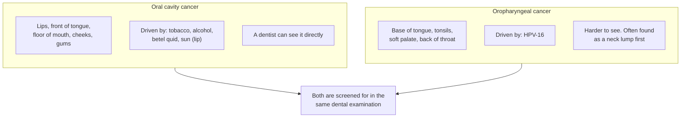
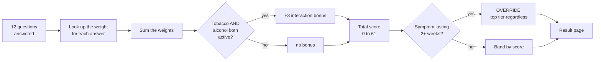
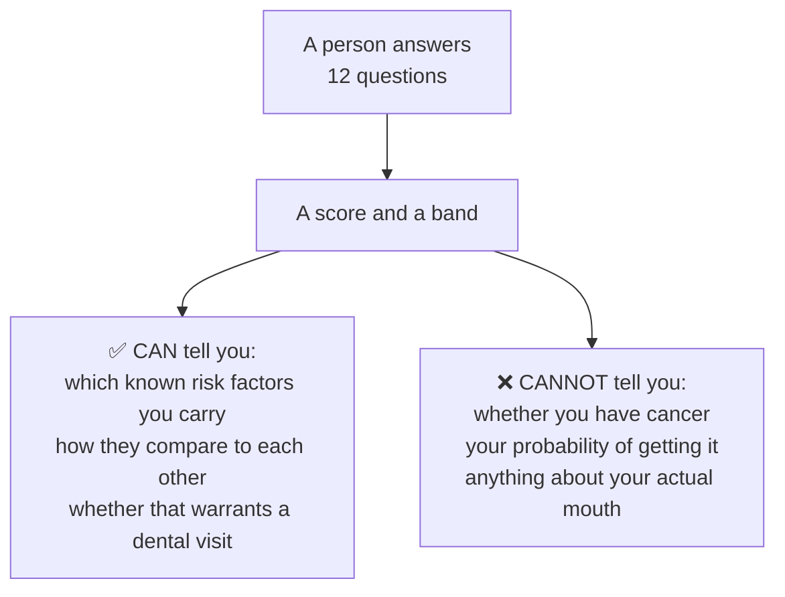
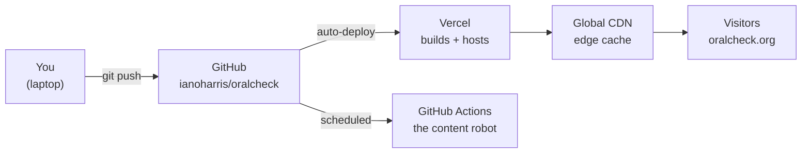
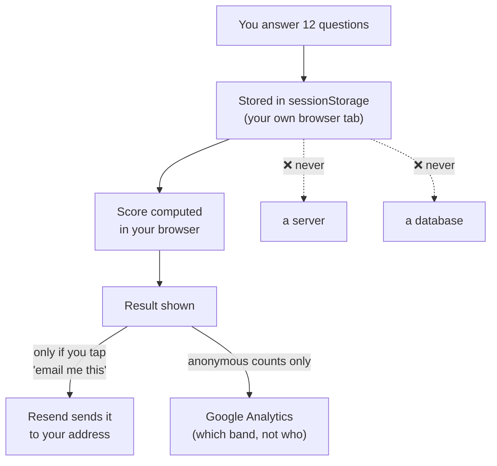
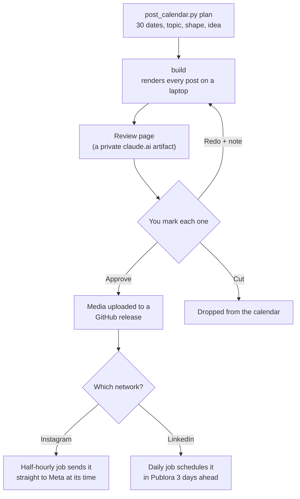
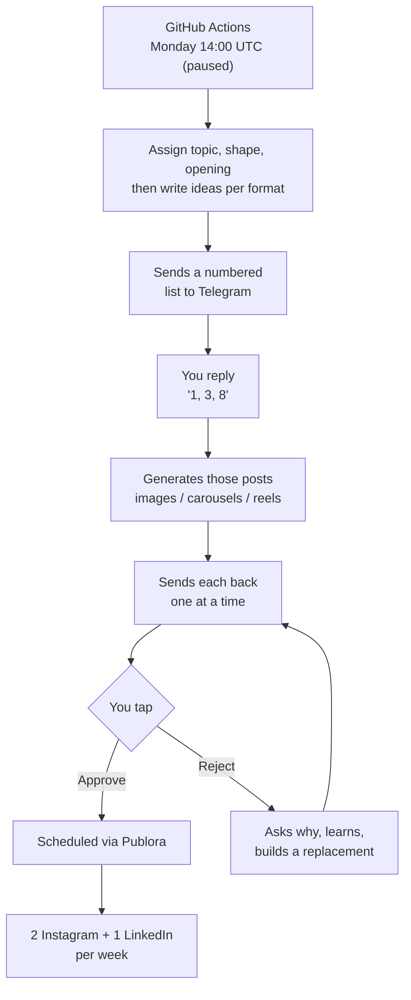

# OralCheck: the owner's guide

**Everything about your own project, in plain language.**

This exists so that when a professor, a dentist, an admissions interviewer, or a
stranger on the internet asks you a hard question about OralCheck, you already
know the answer, including the answers that aren't flattering.

Read it once end to end. After that, use the table of contents.

Last updated: **2026-10-23**
Maintained by: Claude, on request. Ask it to update this file whenever something
structural changes. See [Keeping this current](#15-keeping-this-current).

---

## Contents

1. [The 60-second version](#1-the-60-second-version)
2. [The medicine](#2-the-medicine)
3. [How the score actually works](#3-how-the-score-actually-works)
4. [Why every question is in there](#4-why-every-question-is-in-there)
5. [What it deliberately does not do](#5-what-it-deliberately-does-not-do)
6. [Decisions, and why they went that way](#6-decisions-and-why-they-went-that-way)
7. [How the site is hosted](#7-how-the-site-is-hosted)
8. [The tech, part by part](#8-the-tech-part-by-part)
9. [Privacy and security](#9-privacy-and-security)
10. [The content robot](#10-the-content-robot)
11. [Analytics: what you can and can't know](#11-analytics-what-you-can-and-cant-know)
12. [Who has looked at this](#12-who-has-looked-at-this)
13. [Questions you will get, and how to answer them](#13-questions-you-will-get-and-how-to-answer-them)
14. [What breaks, and how you'd know](#14-what-breaks-and-how-youd-know)
15. [Keeping this current](#15-keeping-this-current)
16. [Glossary](#16-glossary)

---

## 1. The 60-second version

OralCheck is a free web page that asks **12 questions** about things known to
raise oral cancer risk, adds up a score, and tells you which of four risk bands
you fall into and what to do next. It takes about two minutes. It requires no
account, and it never sends your answers anywhere.

**The problem it exists for:** oral cancer is very survivable when it is found
early and much less so when it isn't, and most cases are not found early. That
gap is not a treatment problem, it's a timing problem. The thing that closes it
is a two-minute look inside your mouth by a dentist.

**So the job of OralCheck is not to diagnose anything.** It's to move somebody
from "I've never thought about this" to "I'm going to mention this at my next
dental visit." Everything in the product is downstream of that one sentence.

If you remember one framing for hard conversations, remember this one:

> OralCheck is a **risk-assessment questionnaire**. The **screening test** is
> the clinical exam a dentist performs. OralCheck's only job is to make that
> exam more likely to happen.

That distinction matters more than it sounds like it does. See
[Q3 in the FAQ](#13-questions-you-will-get-and-how-to-answer-them).

---

## 2. The medicine

### 2.1 "Oral cancer" is actually two diseases

This trips up almost everyone, including people who should know better. Under
the umbrella term there are two things with different causes, different
patients, and different outlooks.



**Why you care:** HPV-driven oropharyngeal cancer is rising, and it happens in
people who never smoked and rarely drink, which is exactly the group least
likely to think oral cancer applies to them. Meanwhile tobacco-driven oral
cavity cancer is falling in the US as smoking falls.

A tool that lumps them together will reassure exactly the wrong person. That's a
real problem, and it's [handled in section 6.4](#64-one-score-for-two-diseases).

### 2.2 The numbers that justify the whole project

All from **NCI SEER**, the US national cancer registry. These live in one file
(`src/lib/seerStats.ts`) so they can't drift apart across the site.

| | |
|---|---|
| New US cases, 2026 projection | **60,480** |
| US deaths, 2026 projection | **13,150** (about one every 40 minutes) |
| 5-year survival, found **localized** | **88.7%** |
| 5-year survival, spread to **regional** nodes | **69.7%** |
| 5-year survival, spread **distant** | **36.0%** |
| Share of cases found while still localized | **only 26%** |
| Median age at diagnosis | **65** |
| Male vs female incidence | **17.5 vs 6.6** per 100,000 (about 2.6x) |

**The one statistic that is the entire argument:** 88.7% versus 36.0%, and only
about a quarter of cases are caught in the good column.

> ⚠️ **A precision point people will test you on.** Those are *SEER summary
> stages* (localized / regional / distant). They are **not** the same as AJCC
> Stage I–IV. Your site used to present them as "Stage I" and "Stage IV"
> survival, which is mixing up two staging systems. That's been corrected. Never
> say "Stage I survival is 88.7%" — say "localized," or say "found before it
> spreads."

> ⚠️ **Also:** these are *relative* survival rates, meaning survival compared
> with people of the same age and sex who don't have the cancer. It is not a
> prediction for any one person.

### 2.3 The risk factors, and roughly how strong each is

"OR" is an **odds ratio** — how many times more likely the disease is with that
exposure than without. OR 6 means roughly six times the odds.

| Factor | Rough OR | Why it does damage |
|---|---|---|
| Betel quid / paan / gutka | 7–10x | IARC Group 1 carcinogen, works with or without tobacco |
| Tobacco, daily | 2.5–6x | Direct mucosal carcinogen exposure |
| Alcohol, daily | ~3x | Acetaldehyde, ethanol's metabolite, is the actual carcinogen |
| HPV-related history | ~15x for oropharynx specifically | HPV-16 integrates into host cells |
| Tobacco **and** alcohol together | ~15x for the heaviest users | More than multiplicative. Alcohol appears to increase mucosal permeability to tobacco carcinogens. The figure is for more than a pack a day plus three or more drinks a day, oral cavity, from a pool of 17 studies (Hashibe 2009). You will see "35-fold" quoted too: see Q6a |
| Age 65+ | ~4x | Cumulative exposure plus age-related immune change |
| Immunosuppression / transplant / prior head-and-neck radiation | ~2–4x | Reduced immune surveillance of the mucosa |
| Male sex at birth | ~2.6x raw | Partly, but not entirely, explained by historical tobacco and alcohol use |
| Family history, first-degree | ~2x | Part inherited, part shared environment |
| Low fruit and vegetable intake | ~2x | Weakest causal evidence of the modifiable factors |
| Sun exposure (lips) | 2–3x | Lower lip only. Behaves like a skin cancer |

---

## 3. How the score actually works

### 3.1 The formula

Every answer is worth points. The points come from a formula, not from vibes:

```
weight = round( ln(OR) × 4.47 )
```

**Why a logarithm?** Because risks multiply rather than add. Someone with two
risk factors doesn't have "risk A plus risk B," they have roughly "risk A times
risk B." Taking the natural log turns multiplication into addition, so you can
just sum the points. This is the same structure the Framingham cardiovascular
risk score uses.

**Where 4.47 comes from:** it's an anchor, chosen so that daily tobacco (OR 6.0)
lands on a weight of 8. Every other weight follows from that one choice, so the
whole scale is internally consistent. Internally consistent is not the same as
right: the September 2026 sensitivity analysis (section 3.4) found that 6.0 is
above the published range for current smoking and oral cavity cancer (about
3.4), so the anchor itself is the weakest number in the formula.

Worked example: alcohol, daily, OR ≈ 3.0
```
ln(3.0)  = 1.0986
× 4.47   = 4.91
round    = 5 points
```

### 3.2 The full pipeline



### 3.3 The bands

| Band | Score | What it means |
|---|---|---|
| Low | 0–4 | Nothing stands out. Keep up routine dental visits |
| Moderate | 5–13 | A few things worth mentioning to your dentist |
| Elevated | 14–22 | Several factors stacking. Book a visit this month |
| See a dentist soon | 23+ | Book soon, and say why when you call |

Reference points so you can sanity-check any result in your head:

- A daily smoker and nothing else = **8** (moderate)
- Tobacco + alcohol + the interaction bonus = **16** (elevated)
- Betel + tobacco + alcohol + bonus = **25** (see a dentist soon)
- Male sex at birth alone = **3** (still low, correctly)

**Where the +3 comes from.** Because the points are logarithms, adding the
tobacco and alcohol points already treats the two as multiplying. The pooled
study of 17 case-control studies (Hashibe 2009) found the real joint effect is
bigger than that, about 2.15 times what multiplication alone predicts across
head and neck cancer (3.09 for the mouth itself). Put 2.15 through the same
formula and it comes out at 3 points. The mouth-only figure would give 5, so 3
is the cautious choice. Until October 2026 the methods page justified it with a
"15x versus 9x" comparison that did not hold up, and is now replaced.

### 3.4 Two things about the bands you should be honest about

**Nothing derived those four numbers.** They were set by judgment against those
reference profiles, then sanity-checked so the bands aren't all-but-empty or
all-but-full. There is no sensitivity, no specificity, no ROC curve behind them,
because producing those requires outcome data this tool has never had. The
methods page says this outright.

**The bands didn't move when the maximum did.** When the sex and immune
questions were added, the maximum went from 53 to 61. Rescaling the bands
proportionally would have pushed the top band's boundary to 26 — which would
have quietly *demoted* an unchanged betel + tobacco + alcohol profile from the
top band to the one below. A new question must never make an existing person
look safer, so the boundaries stayed put.

**How fragile the bands are, in numbers (September 2026).** A sensitivity
analysis let every weight's source odds ratio wander across its published
confidence interval, ten thousand times, and re-tiered every possible set of
answers each time. Three quarters of profiles keep their band on at least 95%
of draws. The boundary between Elevated and High is the shaky one: one profile
in five can land on either side of it. The bigger finding is *why*: the
intervals themselves move only about 6% of band assignments, but several of the
point estimates disagree with the meta-analyses. The tobacco anchor (OR 6.0) is
above the upper bound of both meta-analyses of current smoking and oral cavity
cancer, which puts the whole scale in units that are too large; past betel use
is weighted as if quitting removes most of the risk when the published data say
it removes little; occasional tobacco is weighted well above its closest
published category. None of this is a validation, and the write-up says so. The
whole thing, with sources, is `docs/SENSITIVITY_ANALYSIS.md`, and it can be
re-run with `scripts/sensitivity_analysis.py` whenever a weight or a boundary
changes.

### 3.5 The symptom override

If someone reports a sore, patch, lump, gum growth, loose tooth, or swallowing
difficulty lasting **2+ weeks**, they go to the top tier no matter what their
score is.

Reasoning: a symptom is not a *risk factor*, it's possible *existing pathology*.
Risk factors say "you're more likely to develop this." A symptom says "something
is already happening, go look at it." Those deserve different handling, and the
symptom always wins.

---

## 4. Why every question is in there

| # | Question | Why it earns its place |
|---|---|---|
| 1 | Age | Strongest non-modifiable predictor. Also a proxy for cumulative exposure to everything else |
| 2 | Sex at birth | Men diagnosed ~2.6x more. Weighted from a conservative OR 2.0, not 2.6 — see 6.2 |
| 3 | Tobacco | The anchor for the whole scale. Combustible and smokeless both count |
| 4 | Alcohol | Group 1 carcinogen, clear dose-response. Frequency matters more than what's drunk |
| 5 | HPV | Leading cause of oropharyngeal cancer under 50. Asked as a proxy — see 6.3 |
| 6 | Sun exposure | Lower **lip** specifically, not inside the mouth |
| 7 | Symptoms | Treated as possible existing pathology, not exposure. Overrides the tier |
| 8 | Family history | First-degree relative roughly doubles risk. Part environment, hence modest weight |
| 9 | Immune / radiation history | Added Aug 2026 after clinical review. Three exposures, one mechanism |
| 10 | Diet | Weakest causal evidence of the modifiable factors, weighted accordingly |
| 11 | Dental visits | **Not a risk factor at all.** A detection-delay proxy — see 6.5 |
| 12 | Betel quid | Highest single weight. Asked of everyone, not gated by region — see 6.6 |

---

## 5. What it deliberately does not do

Know these cold. Volunteering them is what makes you credible; being caught not
knowing them is what doesn't.



1. **It cannot tell you whether you have oral cancer.** It never sees your mouth.
2. **A low score is not a clean bill of health.** Roughly a quarter of oral
   cancers occur in people with none of the conventional risk factors. A low
   score *with a symptom* still means go.
3. **The score is not a probability.** A 20 is not twice the risk of a 10. It's
   an ordinal ranking, not a percentage.
4. **It has never been validated against outcome data.** The weights come from
   published literature; the instrument as a whole has never been tested against
   a real cohort. Never call it "validated."
5. **The weights are pooled from studies in different populations.** Tobacco from
   a smoking meta-analysis, betel from South and Southeast Asian populations, HPV
   from a US case-control study — then applied to whoever opens the page. That
   assumption is untested and is the single largest source of uncertainty.
6. **The band boundaries were set by judgment**, not derived.
7. **It relies on self-report.** Tobacco and alcohol are consistently
   under-reported on self-administered questionnaires.
8. **One score covers two diseases.** See 6.4.
9. **It can't replace the exam**, which is the entire point.

---

## 6. Decisions, and why they went that way

This is the section that answers "why did you do it *that* way?"

### 6.1 Why one score instead of a percentage risk

A percentage would require a validated model against outcome data. Presenting a
made-up percentage as if it were a probability would be the single most
dishonest thing the tool could do. Bands communicate "more or less concerning"
without pretending to a precision that doesn't exist.

### 6.2 Why sex is weighted at OR 2.0 when SEER says 2.6

Because part of the male excess *is* tobacco and alcohol — which the tool already
scores separately. Using the full 2.6 would count the same exposure twice.
Deliberately conservative.

### 6.3 Why HPV is asked as a proxy, and weighted low

You can't ask a stranger for their HPV serostatus on a web page. So vaccination
status and reported history stand in for it. This is the **weakest inferential
step in the whole instrument**, and the weight (5) is set far below the true OR
for confirmed HPV-16 (~15) to reflect that.

### 6.4 One score for two diseases

Both reviewing clinicians raised this independently. Two obvious fixes were
considered and **rejected**:

| Option | Why not |
|---|---|
| Split into two scores | The oropharyngeal one would rest on a single question. A one-question score is not a score |
| Drop HPV, cover oral cavity only | Removes the fastest-growing part of the disease, in exactly the age group least likely to be worried |

**What was done instead:** the score stayed whole — the recommendation is the
same either way, since one exam covers both sites — and the *explanation*
changed. Every question is tagged with the disease it speaks to, and the results
page names which one your factors point at. Shared factors (age, sex, family,
immune, symptoms, dental) are excluded from that comparison so they can't drag
every profile toward whichever site has more questions. A site is only named when
its weight is at least twice the other's.

Critically: when the factors point at the **oropharynx**, the page says outright
that the score probably *understates* the risk, and why. Hiding a known
under-estimate behind a reassuring number was the failure mode worth avoiding.

**Still open:** whether the HPV weight should now rise, since the reason it was
deflated is weaker now that the page discloses the blending. That's a question
for Rawal and Brant, not for you to decide alone.

### 6.5 Why dental visits are in a risk questionnaire

They aren't a risk factor and the page says so. They're a **detection-delay
proxy**: only about 26% of cases are found while localized, and the exam that
finds them earlier happens at a dental visit. Its weight comes from clinical
rationale rather than an odds ratio, and it's the only entry in the table where
that's true.

### 6.6 Why betel quid is asked of everyone

It's the highest-weighted single exposure and an IARC Group 1 carcinogen
independent of tobacco. It could have been gated behind a "where are you from"
question, but the tool is used well outside the countries where use is most
common, and gating it would have missed exactly the diaspora users most at risk.

### 6.7 Why nothing is stored

The score is computed **in your browser**. Answers never reach a server. This
was a deliberate design constraint from the start and it pays for itself three
times over: it removes essentially all privacy risk, it removes the need for an
account (which would tank completion), and it very likely puts the tool outside
"human subjects research" for IRB purposes, because no data about a living
individual is ever obtained.

### 6.8 Why the product is still called a "risk screener"

Strictly, it's a risk-assessment questionnaire. But "screener" is accurate on the
reading that it screens *risk factors*, not tissue — and renaming it would cost
the title tags, meta descriptions, and search positioning of every page in three
languages. The rule adopted instead is narrower and easier to hold:

> Never say OralCheck *performs* a screening. Never call its output a *screen
> result*.

---

## 7. How the site is hosted



**In plain terms:** you write code on your laptop and push it to GitHub. Vercel
is watching that repository. Every push to `master` triggers an automatic build,
and if the build succeeds the new version goes live within a couple of minutes.
There is no "upload the site" step and no server you maintain.

**Where things physically are:**

| Thing | Where | Notes |
|---|---|---|
| Source code | GitHub, `ianoharris/oralcheck` | The single source of truth |
| The live site | Vercel | Auto-deploys from `master` |
| The domain | `oralcheck.org` | Points at Vercel |
| Secrets (API keys) | Vercel env vars + GitHub Secrets | **Never in the code** |
| Articles | `content/published/` in the repo | Markdown files, not a database |
| Translations | `messages/en.json`, `es.json`, `pt.json` | English is the source; the others are generated |

**There is no database.** That surprises people. Everything the site shows is
either baked in at build time or computed in the visitor's browser.

---

## 8. The tech, part by part

### 8.1 The stack

| Layer | What | Why it's there |
|---|---|---|
| Framework | **Next.js 16.2.4** | React with server rendering, so pages are fast and Google can read them |
| UI | **React 19** | The component library everything is written in |
| Styling | **Tailwind CSS** | Utility classes, so styles live next to markup |
| Languages | **next-intl 4.13** | Handles `/es/` and `/pt/` URLs, translations, hreflang tags |
| Animation | **Framer Motion** | The screener transitions |
| Maps | **Leaflet** | The find-care map. Free, no Google Maps billing |
| Email | **Resend** | Sends the "email me my result" copy |
| AI summary | **Anthropic SDK** | The personalised paragraph on the results page |
| Analytics | **Google Analytics 4** + Vercel Analytics | |
| Hosting | **Vercel** | |

### 8.2 The pages

```
/                       home
/screener               the 12 questions
/results                the score, bands, explanation
/find-care              map + clinic search
/methods                ⭐ the credibility page. Every weight, every source
/learn/...              9 hand-written guides, plus published articles
                        served from content/published/ (11 so far)
/for-clinicians         embed code, flyer, the professional framing
/about  /privacy  /terms  /press
/qr                     printable QR generator for flyers
```

`/methods` is the most important page on the site. It's what a sceptical
clinician reads before deciding whether to take you seriously.

**The home page's third number is live.** Under the hero, the three figures
are new US cases a year, survival when caught early, and **people reached since
launch**, which the site reads from Google Analytics every hour
(`src/lib/reach.ts`, using the `GA_PROPERTY_ID` and `GA_SERVICE_ACCOUNT_KEY`
values stored on Vercel). The home page itself is rebuilt in the background at
most once an hour, the first time someone visits after the hour is up. For its
first day it was not: the page was built once per deploy, so the number stayed
at whatever it was on deploy day (855) until you noticed on 22 October. It always shows a "+", because GA is a floor: it
misses anyone with an ad blocker, and it missed most visits from 22 September
to 21 October 2026. If the GA read ever fails, the page quietly shows the last
total read by hand (847, on 21 October 2026) and drops the "Live" label. It
replaced "2 min, is all a dental screening takes" on 21 October 2026.

The `/learn` index page shows six of the nine guides as cards, two rows of
three. Facts & Stats, HPV, and Prevention are left off the grid because the
Overview and Risk Factors cards already cover most of what they say. Those
three pages still exist and are still linked from the footer, the sitemap, and
other learn pages, so nothing that pointed at them broke. To swap one back in,
edit the list at the top of `src/lib/learnArticles.ts`.

Below the cards, the five newest articles show, with a "Load more" button that
adds five at a time. Every article link is already in the page for Google; the
button only unhides them, so the extras still count for search.

**How a published article is laid out.** The weekly SEO articles are set like
the patient pages of a medical journal (NEJM, JAMA, BMJ, the British Dental
Journal), because that is what reads as careful and trustworthy:

```
PATIENT GUIDE                         ┌ IN THIS ARTICLE ─┐
Title                                 │ 1 First heading  │   ← desktop only,
One or two sentences (the standfirst) │ 2 Second heading │     stays in view;
──────────────────────────────────    │ ...              │     on a phone it is
Published 20 July 2026 · 5 min read   └──────────────────┘     a fold-out list
Body text, about 70 characters a line
──── hairline, then the next heading
...
Sources (only if the article links to outside sites)
Medical disclaimer (the article's own wording)
Screener box  ·  More patient guides  ·  "Published by OralCheck"
```

Everything on that page comes from the markdown file itself. Nothing is made
up: the standfirst is the first sentence or two of the article's opening
paragraph (moved up, not copied), the contents list is the article's own
section headings, and the numbered Sources list only appears when the article
links to an outside source. Today none of them do, so no article shows one.

There is deliberately **no author line**, because the articles do not name an
author. Four optional lines can be added to the top of any article file, and
the page uses them if present: `description:` (replaces the automatic
standfirst), `keyPoints:` (a short "Key points" list under the title),
`updated:` (adds "Updated" to the date line) and `author:` (adds "By ...").
Only put a name in `author:` if that person actually wrote it, and a
clinician's name only with their written agreement.

What it does not copy from journals, on purpose: author affiliations, DOIs,
citation counts, abstracts and serif body text. Those belong to research
papers, not to a guide for patients.

### 8.3 The server-side bits

There are only seven, and most are tiny:

| Route | Does | Protected by |
|---|---|---|
| `/api/summary` | The AI paragraph on results | Rate limit 10/window + daily AI budget |
| `/api/email-result` | Emails a result copy | Rate limit 3/hour |
| `/api/contact` | Feedback form | Rate limit 3/hour |
| `/api/clinics` | Clinic search | Rate limit 10/window |
| `/api/geocode` | Address → coordinates | Rate limit 20/window |
| `/api/publish` | Publishes a draft article | **Admin secret** |
| `/api/draft` | Reads a draft | **Admin secret** |

### 8.4 The one thing to understand about the risk engine

`src/lib/riskEngine.ts` runs in **two** places: in the browser on the results
page, and on the server when emailing a result. That's why it can't use normal
React translation hooks and uses a lower-level primitive instead. If you ever see
odd translation behaviour on results, that's the file to look at.

---

## 9. Privacy and security

### 9.1 Where answers do and don't go



`sessionStorage` is per-tab and dies when the tab closes. Nothing persists.

### 9.2 What the security review found and fixed

Worth knowing because it's the most serious thing that's happened to the project:

- **`/api/publish` had no authentication at all.** It commits to and deletes
  from the GitHub repo. Anyone who found the path could have pushed an
  unreviewed article onto a health site or deleted drafts. Now behind a shared
  secret that **fails closed** — if the secret is missing, the route returns 503
  rather than allowing everything.
- **The rate limiter trusted a spoofable header.** Fixed to use Vercel's
  trusted header instead.
- **`/api/geocode` was unmetered.** Now rate limited.
- **A Content-Security-Policy was added**, plus `X-Content-Type-Options`,
  `X-Frame-Options`, `Referrer-Policy`, and a `Permissions-Policy` that denies
  camera, microphone and geolocation outright.

### 9.3 Rules that exist for a reason

- **API keys never go in the code.** Vercel env vars and GitHub Secrets only.
- **Never paste a token into a chat.** Put it straight into the secret store.
- **`/review/` pages are `noindex` and `no-store`.** They're drafts.

---

## 10. The content robot

About 10,000 lines of Python in `oralcheck-agent/` that runs your social media.

**Right now it runs from a calendar, not a weekly vote.** From late October
2026 to early January 2027 every post is decided in advance: thirty of them,
three a week, built all at once and reviewed on one page.



**Instagram goes straight to Meta; LinkedIn goes through Publora** (since
26 October 2026). Publora's plan holds only three scheduled posts at a time,
across every network, and that cap was what limited the feed. Meta's own
limit is 100 posts a day per account. Two consequences worth knowing:

- **Instagram's API cannot schedule a post**, so a small job runs every half
  hour and publishes whatever is due. GitHub sometimes starts scheduled jobs
  late (the daily one has started up to six hours late), so a post can go out
  a little after its time. A post more than six hours late is held back and
  you get a Telegram message instead.
- **The Meta login is a token that lasts 60 days.** A weekly job renews it and
  saves the new one itself. If renewing ever fails, you get a Telegram
  message, and posting stops when the token runs out. To make a new one: the
  OralCheck app on developers.facebook.com, Instagram use case, "API setup
  with Instagram login", Generate token, then save it as the repo secret
  `INSTAGRAM_ACCESS_TOKEN`.

The switch is the repo variable `IG_DIRECT`: 1 sends Instagram to Meta, 0
puts it back on Publora. A "Diagnose Instagram Token" workflow checks the
connection and has Meta prepare a picture and a reel without posting them.

**Why a calendar.** The weekly run had to wait for your picks and your
Telegram taps inside one GitHub job, and GitHub kills every job at six hours.
In October two Mondays in a row were killed mid-run and nothing was scheduled.
Building everything ahead on a laptop, where time is not capped, and letting
small jobs hand each approved post on removes the deadline entirely.

**The mix.** Ten reels, ten carousels, ten single images. Every regular post
goes out at 10am Central on a Monday, Tuesday or Thursday, because that is when
your followers are most active (9am to noon on those days, from your Instagram
insights, 22 October). Planned batches put Instagram on Monday and Thursday and
LinkedIn on Tuesday. One reel a week. Holiday posts keep their own day and time:
Halloween (Saturday 31 October, 5pm), the Great American Smokeout (its
LinkedIn post goes the day before, since it says "tomorrow"), Thanksgiving
(Thursday 26 November, 5pm) and the new year.

**You are still the approval gate.** Nothing is scheduled unless you marked it
Approve on the review page. A post you send back with Redo is rewritten with
your note added to its brief, and comes back to the page as a fresh, undecided
version. An approved post whose date has already passed is skipped, not
posted late. Reels still get the Telegram reminder to reshare them to a Story.

**The weekly Telegram flow** below still exists and still works, but its
Monday schedule is paused while the calendar runs. It can be started by hand
from the Actions tab.



**The weekly plan** is `WEEKLY_PLAN=instagram:2,linkedin:1`. Each post targets
**one** network, not all of them, because Publora's plan counts every
network a post targets as its own scheduled slot — three posts across two
networks would need six slots against a cap of three.

**LinkedIn gets a rewritten caption** (longer, professional, no hashtag wall).

**Where ideas come from.** The robot does not pick its own subjects any more.
Left to choose, it kept returning to the same five or six (survival by stage,
HPV overtaking tobacco, the yearly case count) in the same grammar ("X. Y.",
"Most people don't know"), so the feed read like one post rephrased. Now code
(`topics.py`) assigns every slot in the weekly batch three things before the
model writes a word:

- **a topic**, from a bank of 36 drawn from the site's own learn pages (the
  floor of the mouth, the wipe-away test for thrush, the vaccine's age range,
  low-cost dental care, and so on). It picks the one used least recently, so
  everything comes round before anything repeats. Each topic carries the facts
  it may use and the page they came from, which is how a post can only claim
  what the site already says.
- **a shape**: a quiz, a myth taken apart, an illustrated how-to, a side-by-side,
  a two-week calendar, a notes-app checklist, one big number, and so on.
- **an opening style**: a question, a concrete moment, a physical instruction,
  a number, a contrast. No two posts in a batch open the same way.

Any title that still comes back with a worn phrase ("most people", "did you
know", "here's why", "actually") or the "X. Y." shape is rewritten once and
dropped if it fails again.

**How posts are drawn.** Carousels and single images use the original
designs (`render_html.py`): serif headlines, layouts such as myth, compare,
steps, timeline, big number and checklist. A newer set of templates ran for
one week in October and was dropped because it felt too playful. Nothing is
AI-generated imagery.

**What picture a post gets** is decided by its topic, not by searching a
stock library (`topics.VISUAL`). When you reviewed the autumn calendar you
sent back every image whose stock photo was only loosely related (a woman
touching her neck for HPV symptoms, two teenagers for the vaccine) and kept
the ones that showed the thing itself. So now a post shows one of four
things:

- **the place in the mouth**, as a still from the same drawings the reels use
  (the tongue, the cheek, the lips, the floor of the mouth, the neck), with
  the part in teal and a label. HPV throat posts use the calm side view of the
  tonsils and base of the tongue rather than the open mouth up close, which you
  found intimidating. Stills are drawn at twice the size so they stay sharp;
- **the list itself**, for posts that are a list (six HPV throat symptoms, five
  harmless look-alikes): a big numeral per item and no picture, after you
  pointed out the picture hid the list;
- **the sign itself**, either one of the two clinical photos with attribution
  on file (`white`, `mixed`), or a drawing of it from the plates (a red patch,
  a sore that does not heal, lichen planus, or thrush beside a white patch for
  the "does it wipe away" post). A drawing always says, on the picture or in
  its caption, that it is an illustration and not a real case, and that no
  clinician has reviewed it;
- **a stock photo of a literal subject** (betel quid, a dentist at work, a
  vaccine vial), and only if an automatic check of the photo confirms it
  actually shows that subject;
- **no picture at all**, for numbers and risk statements, where any photo
  would be decoration.

**Sources.** A post that makes a research or statistics claim names its
source: a short line on the slide or reel ("Source: Hashibe et al., 2009"),
and the full reference with a link in the caption. Sources come from a fixed
list (`topics.CITES`) of papers the site already cites, each checked against
PubMed. Posts that only say where to look or how to check cite nothing.

**How carousels are built to be read.** Instagram re-shows a carousel nobody
swiped starting from slide 2, so slide 2 has to make sense alone. When a
carousel has a picture of the place or the sign, it is slide 2, straight
after the cover, so it says what the deck is about before the steps begin
(it used to come after the first step, which put a picture of the mouth
between "grab a mirror" and the rest of the steps). A myth slide
puts the fact first and the myth once, smaller (the approach recommended by
the Debunking Handbook). Every slide has a swipe arrow and content slides carry
the source line. The last slide asks people to save it or send it to someone
before giving the address, because saves and sends are what Instagram ranks
on and a link on a slide cannot be tapped.

**How reels are made.** Reels are drawn. Each one is four or five spoken
lines over the two illustrated plates described further down (the open mouth
from the front, and the head in section from the side). As each line is read,
the view glides to the part it is about, the part turns teal, and a thin label
draws in after a tap; a line about the floor of the mouth, the base of the
tongue or the roof of the mouth crosses over to the side view, where those can
actually be seen. **What lights up is decided by what the voice says**: a line
naming the inner cheek lights the cheek, a line naming the tongue lights the
tongue, and a line naming no particular place stays on the reel's own subject
and never lights the teeth. (Three reels in the first calendar draft got this
wrong, and the 3D model could not show the lips, cheeks or palate at all,
which is how "patches on the inner cheek" ended up pointing at the floor of
the mouth.) When a line names a sign, its drawing fades in at the place the
line names: "a white patch on the side of the tongue" shows the white patch
there. A sign is never drawn somewhere the line did not put it, and whenever
one is on screen a footer says it is an illustration for education, not a
real case, and not reviewed by a clinician. The label picks its side of the
screen once per shot and stays there (the reel posted early on 21 October had
labels hopping side to side; a test now plays every labelled shot and fails
if a label moves). Captions firm up word by word in time with the voice
(Kokoro on fal), the sound is quiet (a soft click on each tap, air as the view
moves, a low tone under the end card, the usual music bed), and the reel ends
on a card with the address. It costs nothing beyond the voice and music
already used, and renders in a few minutes on any computer, so the free GitHub
machines have no trouble with it. The drawings are traced from a CC BY-SA
atlas, so every reel and every post using a plate carries a credit line, on
screen and in the caption, and is itself shared under that licence. If a
render fails in the weekly run, it builds the older text-only reel instead so
the week is not lost. Calendar builds do not: they retry, because a silent
swap to the old look once went unnoticed. **Reels were 3D from 20 to 26
October** (a trimmed model of the jaw, teeth, tongue and mouth floor); they
moved to the drawings on 26 October, after the review below.

**Animated reels (samples, 26 October).** You pointed out that animation gets
views (your 3D skull reel doubled your average) and that reels are what drive
people to the site. So there is now a house style for animated reels
(`oralcheck-agent/anim/STYLE.md`): warm paper background, teal only for the
thing being talked about, clay-white everything else, no faces, captions in
time with the voice, the readout of one meaningful number, a source line on
screen and the usual end card. It mixes the 2D drawings with 3D. Two samples:
"why does your dentist grab your tongue with gauze?" (2D, from the NIH's own
exam card) and a zoom from the jaw down to the cells that line the mouth and
back (3D, from the American Cancer Society). Every idea is checked first
against what the feed has already posted, because the core topics are played
out, and every claim has a checked source shown on screen. If asked whether
the cells are real: they are an illustration whose shapes and layers follow
the textbook, not the real number of cells, and the credit line says so.

**Music level.** The music sits a fixed 24 decibels under the voice, measured
on every reel. It used to be a fixed volume setting, which only suited one
track: the generated music beds are mastered louder, and you heard them as
"way too loud". 18 decibels was still too loud for you on the 6 November reel,
so it went to 24.

**The look of animated and calendar reels.** They use the brand's own type:
DM Serif Display for titles, labels and numbers, Source Sans in sentence case
for everything small. The first samples used a monospace, all-caps style with
a step counter that you said looked "so claude code"; that is gone.

**A fuller model, waiting in the wings.** The reels above use a trimmed
model of the jaw, teeth, tongue and mouth floor. A second model now exists
(`oralcheck-agent/anatomy3d/`), built from the same open atlas but keeping the
whole head and neck: skin, the fat under it, fascia, muscle, bone, teeth,
cartilage, about 240 blood vessels and 105 nerves, the glands, lymph nodes,
eyes, brain, throat and voice box. Each tissue has its own texture (fibrous
muscle, porous bone, lobular fat and glands, moist lining). It can be cut
along the three standard planes: sagittal (left from right, down the middle of
the face), coronal (front from back) and axial (top from bottom), and the cut
face shows each tissue in section. It can also be peeled layer by layer, or
turned to glass with one part highlighted in teal. Two honest limits. The
atlas has no separate skin layers, so the epidermis, dermis and fat are
generated under its skin surface, with the epidermis drawn thicker than real
so it can be seen at all. And the atlas skin is low-detail, so the face looks
like a mannequin rather than a person. To show the skin's layers clearly
there is a separate textbook-style block, cut in steps. Labels on this model
are checked before they are drawn: the page renders every structure in its
own flat colour, and a label appears only if its dot sits on the structure it
names. This was built after the 27 October reel's pointer landed on a tooth,
and it replaces the "aim at the middle of the mesh" rule that caused it. You
can explore it at https://claude.ai/artifact/ECiso41AwjuW8UstJXWYdV. Its
first version used flesh-coloured skin, raw red muscle and a dark background,
and you said it looked terrifying; it was restyled to the reels' pale,
clinical look, and on 22 October the skin and eyes moved to natural colours
after you said the plaster skin looked bad. At your request the skin is no longer shown unless you ask
for it: the page opens on the see-through view, and the cut views open with
the skin and fat peeled back to the muscle. The Skin button and the peel
slider still bring it back. The mouth gets the most realism, because that
is where the cancers OralCheck screens for start. The Mouth view shows the
face with the jaw open: the skin is parted where the lips meet, so the chin
and lower lip move with the jaw and the upper lip lifts off the teeth. A mouth
on a bare skull looked uncanny, which is why the face is there; a switch on the
page turns it off for a cutaway you can turn to any side. The "Back of the
mouth" preset is the view from a throat exam: mouth wide, the back of the
tongue pressed down ("say ahh"), looking up past the top teeth at the uvula,
the soft palate, the tonsils between their two arches, and the back of the
throat. Inside the mouth the colours are matched to clinical photos you sent
(pale coral gums, a pale pink tongue with a whitish coat, ivory teeth), the
light works like a penlight, and the wet surfaces catch small glints of
saliva. The ChatGPT textures you made add only the fine detail; they are
illustrations, not photos of a real person. Several parts are not in the atlas
and are built to fit what is around them: the lips, cheek lining, inner lips,
floor of the mouth, the arches of the throat, its back wall, and the lining of
the soft palate. The atlas's tonsils sit oddly high and small, so they are
moved down into the niche between the arches, where tonsils sit in life. If
someone asks, those parts are careful approximations, not scanned anatomy.
**Since 23 October the head has no skin at all**: you found it too frightening,
so the skin, the fat under it and the eyelashes and brows are left out of the
model (one switch in `export_head.py` brings them back). The head now opens at
the muscle, the mouth views are cutaways with no face, and the Skin button, the
face switch and the Lips preset are gone; the skin's layers are still shown in
the separate block. A full review of the model, and of whether a different
approach would look more professional, was done on 23 October; see "The review,
and the illustrated route" below. The notes below on the skin describe how it was built, for the
record. Where the lips meet was placed by you, on a page of sliders, on 22 October:
the atlas's own mouth slit sat about 1.5 cm too low, so it is sealed and the
skin opens on your line instead. The atlas skin is a hollow shell made of
pieces that do not quite meet, which showed as a dotted line down the chin and
neck, dark specks on the neck and cut-looking smile lines. The skin is now
rebuilt a few millimetres outside the shell and pulled back onto it, which
closes those gaps; the ears, eyes and nostrils are too tightly curved for that
and are handled gently. Seen from below, the nostrils are still rough. There
is a 70-second screen recording of the model
(`oralcheck-agent/anatomy3d/stills/oralcheck_head_demo.mp4`), made by
`demo_video.py`, which can be re-run whenever the model changes.
Earlier versions made muscle and vessels look like painted concrete: fine
texture turned into glittering grain at normal viewing distance. Every fine
pattern now fades out before it gets that small. The skin was plaster white
with a stucco texture, which made the head a mannequin; it is now a natural
skin tone, warmer over the cheeks, nose and ears, with pores that show only up
close, and the eyes have soft hazel irises. It is all drawn by the program,
not a downloaded skin photo, so there is nothing to license. Reels do
not use it yet: it renders quickly on your Mac's graphics chip, but would be
very slow on the free GitHub computers that build the weekly reel.

**The review, and the illustrated route (23 October).** You said the head
model felt off and suspected a better solution. The review
(`docs/MODEL_REVIEW.md`, and as a page with pictures at
https://claude.ai/artifact/6fwVAT9B2fAG7iYq6ffYbj) found you were right, and
why. The atlas the model comes from was built for students to click through,
not for pictures: its parts are hollow shells that often do not close, and the
inside of the mouth, the part that matters most, is mostly pieces the export
script had to invent (cheek lining, throat wall, lips). Cut down the middle, it
shows slivers and blocks. No amount of colour or lighting work fixes shapes
that are not there. And realism without a face is exactly what feels uncanny;
professional anatomy pictures avoid it by showing no face, or only a faint
outline of one. So the recommendation is to stop investing in 3D and use flat,
layered drawings in the textbook style you picked. There are two drawings. The
first is the open mouth from the front, as in a "say ahh" exam, with switches
that show a white patch, a red patch, a red and white patch, a sore that does
not heal, a swollen tonsil and a lip sore where they usually appear, plus lichen
planus, a lacy white pattern on both cheeks that is not cancer but is worth
showing a dentist, because doctors keep an eye on it. The second is a side view
with the head as a faint silhouette, with switches that light up where these
cancers start. Both, two sample posts and two short reels (one drawn, one 3D,
with the same words, for you to compare) are at
https://claude.ai/artifact/HNkBy65udqitq3m3WhvyRW, and everything rebuilds from
`oralcheck-agent/illustration/` with one command. Three things to know if you
are asked. **Are these real?** No. The outlines are traced from the same open
atlas, so the proportions are real anatomy, but the parts the atlas gets wrong
(the soft palate, lips, uvula, tonsils, throat wall) are redrawn by hand, and
the lesions are drawings matched to published photos. **Who checked the
lesions?** Nobody clinical yet, and every frame says so. The review recommends
one dentist or oral pathologist looks at the set once before a series of
lesion posts goes out. **Can others reuse them?** Yes: because they are traced
from a CC BY-SA atlas, they are CC BY-SA too, and every post carries a credit
line. The free alternative with the same look is Blausen Medical's plates,
which are CC BY (credit only); the 3D atlases you may have heard of
(BioDigital, Visible Body, Complete Anatomy) look photoreal and need paid
permission for social posts. Commissioning a professional plate costs roughly
$500 to $3,400. You chose the drawn route on 23 October, so the 3D head
is retired from future work, and on 26 October the reels and post pictures
moved onto the drawings. A drawing of oral thrush was added then for the
"does it wipe away" post (creamy white spots on a reddened tongue, one wiped
to show the red underneath), drawn from the CDC's description rather than
matched to a photo. If someone asks why the site has no 3D model: a
model adds load time and phone trouble and risks looking uncanny, while a clear
drawing does the job people come for, which is knowing where to look and what
to look for. A small optional 3D view is parked on the roadmap for after the
drawings ship.

> **The manual step you can't automate:** no API can put a tappable link on a
> Reel. Captions are plain text; clickable Reel links need Meta Verified Plus.
> The only free clickable route is resharing the reel to a **Story** with a link
> sticker, by hand, which takes about 15 seconds. The bot sends you a reminder
> with the date when a reel is scheduled.

**Holiday posts get their own look.** A post planned for an occasion renders
in a seasonal theme instead of the usual light or dark one: Halloween in a
night theme (moon, bats, a cobweb), Thanksgiving in a fall theme (warm paper,
maple leaves). The decoration sits behind the text, so it never makes a slide
harder to read, and the facts stay as calm and exact as any other post. You
asked for this on 22 October. A new holiday needs a theme added in
`render_html.py` (`THEMES` and `SEASON_DECOR`) and a line in `pick_theme`.

**Other scheduled jobs:** SEO article drafting (Mondays 10:00 UTC), outreach
follow-up tracking (Sundays 12:00 UTC).

**How SEO articles are written.** Each Monday `seo_pipeline.py` takes the next
keyword from `seo_keywords.json` that no existing article already covers,
writes a draft of about 1,000 words in English and Spanish, and leaves it in
`content/drafts/` for you to publish from `/review/<slug>`. When the list runs
dry, Telegram says so. The keywords are real searches: the October batch came
from Google's autocomplete suggestions for oral cancer terms, and deliberately
leaves out treatment and staging searches (which pull articles toward staging
language the site avoids) and vaping or nicotine pouches (the evidence is too
thin to write a confident article). Since 21 October the writer is given the
site's SEER figures and the same checked source list the social posts use, and
is told to state no other statistic, to never use Stage I to IV for survival,
to quote no named person, and to end with a linked Sources section. Before
that it had none of this, which is how two published articles came to say
"54,000 cases" and compare "stage I and stage IV".

---

## 11. Analytics: what you can and can't know

**Events the site sends:**

| Event | Carries |
|---|---|
| `screener_started` | `question_count` |
| `screener_completed` | `risk_tier`, `risk_score`, `has_urgent_symptom` |
| `email_prompt_shown` | `risk_tier` |
| `find_care_click` | `risk_tier`, `risk_score`, `cta_source` |

> ⚠️ **GA4 will not report on any custom parameter until you register it as a
> custom definition, and registration is never retroactive.** Every day one goes
> unregistered is data you can never recover. There are five to register; the
> steps are in `oralcheck-agent/register_ga_dimensions.py`.

**The one number that matters most:** `find_care_click`. It answers "does getting
a result actually send anyone toward a dentist?" Everything else is upstream of
that. As of early September it had fired **zero** times from real users. That
looked like a product finding, but see the caution below: some browsers'
analytics were partly blocked by the site's own security policy (see below),
so treat the zero with caution, and read it again from late October 2026.

**Which button was clicked** is in `cta_source`. The results page shows one big
find-care button per result, so the values split by band:

| `cta_source` | Where it is | Shown on |
|---|---|---|
| `results_hero` | Inside the result card, under the summary | Elevated, high, and any symptom |
| `results_next_step` | The link in next step 1 | Elevated, high, and any symptom |
| `results_primary_cta` | The button under the next steps | Low and moderate only (since 21 Oct 2026; before that it showed on every band at the foot of the page) |

**A caution about completion rate:** for a stretch in August, recorded
completions outnumbered starts, which is impossible. Don't quote a completion
rate from a window that includes 17–18 August.

**A bigger caution, 22 September to 21 October 2026:** Google Analytics
missed about 9 in 10 visits. The site's security policy (the list of other
websites a page may talk to, in `next.config.ts`) allowed
`*.analytics.google.com` but not the plain `analytics.google.com`, and around
22 September Google's tag started sending page views to exactly that address.
Nothing on the site changed that day; the policy had been there since 18 August
and only started to bite when Google moved. Vercel's own counter, which the
policy never blocked, shows real traffic held steady at roughly 10 page views
a day: on 21 September GA caught 18 of Vercel's 20, and from 22 September to
20 October it caught 32 of 285. So **the "huge drop" in GA users from late
September is mostly not real.** Fixed on 21 October by allowing `*.google.com`,
as Google's own guidance lists. For that month use Vercel Analytics (Vercel
dashboard, Analytics tab; the free plan keeps 31 days), and don't compare GA
numbers across 22 September or 21 October.

**How many people have used it, then?** GA's all-time total on 21 October
2026 was 847. The month GA missed had about 60 to 110 more, estimated two ways
from Vercel's counts using the ratios GA showed the month before (285 page
views at 3.8 per person gives about 74; 157 visitor-days at 0.8 people per
visitor-day gives about 126; GA counted 16 of them). So the honest figure is
**about 900 to 960 people** by 21 October. GA cannot be corrected after the
fact (it does not accept back-dated visits, and adding estimated users would be
inventing data), so say "about 900" and, if asked, that a month of analytics
was partly lost. GA also never counts people with ad blockers, before or after
this, so every GA total is a floor.

---

## 12. Who has looked at this

| Person | Role | What they said |
|---|---|---|
| **Dr. Yeshwant Rawal** | Professor, Marquette; **President, American Board of Oral & Maxillofacial Pathology** | Reviewed the methodology, called it "done thoughtfully and based on evidence through relevant literature." Agreed **in principle** to be named, pending his Chair and Associate Dean |
| **Dr. Tiffany Glazer** | Assoc. Professor, UW Oto-HNS | Declined to mentor (bandwidth), forwarded it to departmental research faculty |
| **Dr. Jason Brant** | Assoc. Professor, UW Oto-HNS | Engaged substantively. Three methodology criticisms, one institutional warning |

**Rawal's name is not on the site** and must not go on it until his institution
clears it. Do not quote him publicly before then.

**Brant's three criticisms**, all now addressed on `/methods`:
1. ORs pooled from different populations, applied to a new one — **added** as a
   stated limitation
2. Unclear where the band cutoffs came from — **now stated outright**
3. Oral cavity and oropharynx blended — **addressed**, see 6.4

**Brant's institutional warning, which outranks everything else on your list:**
faculty must disclose anything job-related or using university resources, and he
guessed the source papers came through UW library access. Saying "this is not a
UW project" is not the same as UW *determining* it. Ask your academic advisor.

**His most useful single sentence:** a faculty mentor cannot tell you whether the
risk stratification is *valid* — that needs a **biostatistician**. Those are two
different roles and you'd been asking one person to be both.

---

## 13. Questions you will get, and how to answer them

### From clinicians and academics

**Q1. "Is this validated?"**
No, and the site says so on the methods page. The weights are derived from
published odds ratios, but the instrument as a whole has never been calibrated
against a prospective cohort. There's no sensitivity, specificity or AUC. It's a
risk-stratification and awareness tool, not a validated diagnostic. Validation
would be a genuinely interesting collaboration.

**Q2. "You're pooling odds ratios from different populations."**
Yes, and that's the largest single source of uncertainty in the score — it's
stated as the second limitation on the methods page. The tobacco figure comes
from a smoking meta-analysis, betel from South and Southeast Asian populations,
HPV from a US case-control study. Summing log-odds across them assumes those
effect sizes transport to whoever opens the page, and nothing tests that. There
is a sensitivity analysis over the published confidence intervals
(`docs/SENSITIVITY_ANALYSIS.md`), and it is honest that it cannot test
transportability either: it only shows how much the bands move within the
intervals the source populations reported.

**Q3. "USPSTF says there's insufficient evidence for oral cancer screening."**
Correct, and that recommendation is scoped to **primary care providers and
explicitly not dental providers**. But the sharper answer is that OralCheck isn't
a screening test at all. It's a risk-assessment questionnaire. The screening test
is the clinical exam a dentist performs, and this tool's only job is to make that
exam more likely to happen.

**Q4. "Where did the tier cutoffs come from?"**
Judgment, anchored to reference profiles, then sanity-checked against the
distribution of possible answers so the bands weren't empty or overfull. Nothing
derived them. There's no ROC curve because that needs outcome data the tool has
never had. That's stated on the page.

**Q5. "Oral cavity and oropharyngeal cancer are different diseases."**
Agreed, and it's been the most-flagged weakness in the tool. The score isn't
split, because the second score would rest on one question and the recommendation
is identical either way. Instead each question is tagged with the disease it
speaks to and the results page names which one your factors point at — and when
they point at the oropharynx it says the score probably understates it, because
the HPV weight is a blended compromise.

**Q6. "Aren't you giving medical advice?"**
No. It returns a risk band and tells people to see a dentist. It doesn't
diagnose, doesn't recommend treatment, and says so in the disclaimer on every
result. There's also a Terms of Use.

**Q6a. "I've seen 35-fold for smoking and drinking. Why do you say 15?"**
Both are real and they measure different things. The 35-fold figure is Blot
1988, one US study of about 1,100 patients: oral and throat cancer counted
together, at two or more packs and more than four drinks a day. The site uses
Hashibe 2009, which pools 17 studies and over 11,000 patients and reports the
mouth separately: about 15 times the odds at more than a pack and three or more
drinks a day. Bigger, newer, and about the right disease. Both are cited on the
methods page. Until October 2026 the site said 15 on one page and 30 on another,
and the methods page credited Hashibe with 35.8, which is actually that paper's
figure for the larynx.

**Q7. "Who reviewed this?"**
A board-certified oral and maxillofacial pathologist reviewed the methodology in
August 2026, and a head-and-neck surgeon reviewed it in September. Both raised
substantive points and both were acted on. *(Do not name Rawal until cleared.)*

### From general public / press / interviews

**Q8. "Why did you build this?"**
Your answer, in your words. The factual scaffolding: 88.7% survival when it's
found localized versus 36% once it's spread, and only about a quarter are found
in the good column. That's a timing problem, not a treatment problem, and the
thing that fixes it is two minutes in a dental chair.

**Q9. "Do you store my answers?"**
No. The score is computed in your browser and nothing is transmitted or kept.
There's no account and no database.

**Q10. "What if I get a low score?"**
It means the risk factors this tool asks about don't stand out for you. It does
not mean you're fine. Around a quarter of oral cancers happen to people with none
of these factors. If you have a sore, patch, or lump that's lasted two weeks, go
regardless of what the score said.

**Q11. "Is this a UW-Madison project?"**
No. You're a UW-Madison undergraduate, but the university doesn't sponsor,
endorse or review it, and its name and marks don't appear on it. **Correct this
whenever anyone assumes otherwise**, including if they introduce it that way.

**Q12. "How do you make money?"**
You don't. No ads, no affiliate links, nothing sold, no plan for any. That's
worth saying plainly because it changes how people read the whole thing.

**Q13. "Can I use this in my practice?"**
Yes — there's a `/for-clinicians` page with a printable waiting-room flyer, a QR
code generator, and copy-paste embed code.

---

## 14. What breaks, and how you'd know

| Symptom | Likely cause | Fix |
|---|---|---|
| Site shows old content | Deploy failed | Check Vercel dashboard for a red build |
| Results page shows English on `/es` or `/pt` | A translation key missing | Run `node scripts/i18n-sync.mjs` |
| Results page shows a raw key like `MethodsPage.foo` | English shipped before translations | Same: run the sync |
| AI summary paragraph missing | Anthropic credits exhausted, or rate limit | Check the workspace spend limit — the workspace cap is separate from the org one |
| Idea flow "succeeds" but nothing arrives | Used to be a silent API failure | Now sends a Telegram message with the reason and exits red |
| No Monday idea batch at all, no failed run either | GitHub dropped the cron | A backup cron fires at 19:00 UTC the same Monday. If that misses too, dispatch it by hand |
| Two idea batches on the same Monday | The backup cron ran while the first was still waiting on you | Fixed 2026-09-14: the guard now also skips when another run today is still going |
| A topic you picked never appears and never comes back | A run died between claiming the idea and building it | Fixed 2026-09-14: a fresh batch hands back any claim that produced no post |
| Publora rejects a scheduled post | 3-slot cap reached | Publish or delete something already scheduled. Only LinkedIn uses Publora now, so this should be rare |
| "The Publora connection ... has expired" | Publora's login to that network lapsed (LinkedIn did, 26 Oct 2026) | Reconnect it in Publora, then run the calendar job again |
| An Instagram post did not go out, Telegram says it failed | Meta refused it, or the token expired | The message carries Meta's reason. It retries twice more; run "Diagnose Instagram Token" to see the connection's state |
| Instagram posts go out late | GitHub started the half-hourly job late | Nothing to fix per post. If it is often more than an hour, tell Claude: the publishing job can move somewhere with a reliable clock |
| A calendar date passes and nothing posts | The post was never approved on the review page, or was approved after its date, or its media never reached the release (found 26 Oct 2026: nothing had been uploaded, so nothing was scheduled) | Approve in time; approved posts are uploaded with `post_calendar.py upload` |
| The Monday run ends "cancelled" | GitHub's 6-hour cap per job, found 2026-10-20 | Why the Monday schedule is paused and the calendar is used instead |
| Every route 404s locally | Stale Turbopack cache | `rm -rf .next` |

**A recurring trap:** the Anthropic **workspace** spend limit is enforced
separately from the organisation limit. Raising the org limit alone does nothing.

**A second one, specific to the robot:** its CI tests import the agent, and for
a while importing the agent *exited the process* when no API key was present.
The verify step carries no secrets by design, so the run died with every check
showing green above it. Anything that makes importing a module require
credentials will break CI in a way the log actively mislies about. Keep imports
free of side effects.

**Before quoting any stat**, check `src/lib/seerStats.ts` — it carries a
`lastVerified` date, and the case and death figures are year-stamped projections
that go stale on schedule. **Re-check annually.**

---

## 15. Keeping this current

This file goes out of date. Ask Claude to update it when any of these happen:

- A question is added, removed, or re-weighted
- The band boundaries move
- A clinician reviews it or agrees to be named
- The hosting, stack, or a major dependency changes
- The SEER figures are refreshed
- Something significant breaks and gets fixed
- The social cadence or agent design changes

The instruction to keep it updated also lives in `AGENTS.md`, so any Claude
session working in this repo should maintain it alongside `docs/ROADMAP.md`.

**Related files worth knowing:**

| File | What it is |
|---|---|
| `docs/ROADMAP.md` | What's open, blocked, and shipped. Updated every session |
| `AGENTS.md` | House rules for anyone (human or AI) working in the repo |
| `src/lib/seerStats.ts` | Every epidemiological figure, with source and date |
| `src/lib/questions.ts` | The 12 questions and their weights |
| `src/lib/riskEngine.ts` | The scoring logic and the full methodology comment |
| `outreach-drafts/` | Every email sent or drafted, with reasoning notes |

---

## 16. Glossary

| Term | Plain meaning |
|---|---|
| **Odds ratio (OR)** | How many times more likely the disease is with an exposure than without |
| **Log-linear model** | Adding points that represent multiplied risks, via logarithms |
| **Sensitivity** | Of people who have the disease, what fraction the test catches |
| **Specificity** | Of people who don't, what fraction the test correctly clears |
| **ROC curve / AUC** | A graph of how well a test separates cases from non-cases |
| **SEER** | The US national cancer registry. The source for every stat here |
| **Summary stage** | SEER's staging: localized / regional / distant. **Not** AJCC I–IV |
| **Relative survival** | Survival compared to people of the same age and sex without the cancer |
| **Leukoplakia** | A white patch that doesn't wipe away. Can be pre-cancerous |
| **Erythroplakia** | A red patch. Higher chance of being pre-cancerous than leukoplakia |
| **Oropharynx** | Back of the throat: base of tongue, tonsils, soft palate |
| **IARC Group 1** | The WHO's classification for "definitely causes cancer in humans" |
| **IRB / HRPP** | The committee that reviews research involving human subjects |
| **hreflang** | HTML tags telling Google that pages are translations of each other |
| **CSP** | Content-Security-Policy. Restricts what a page is allowed to load |
| **sessionStorage** | Browser storage that lives in one tab and dies when it closes |
